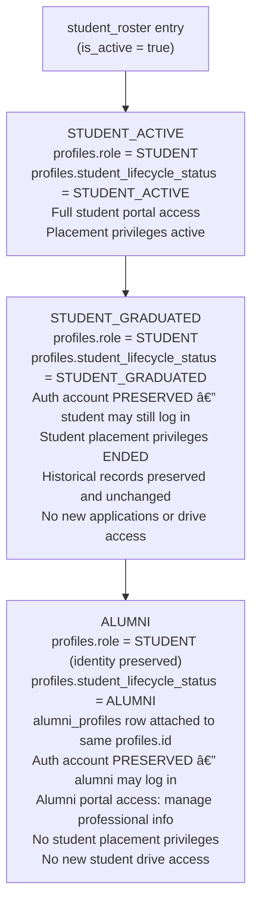
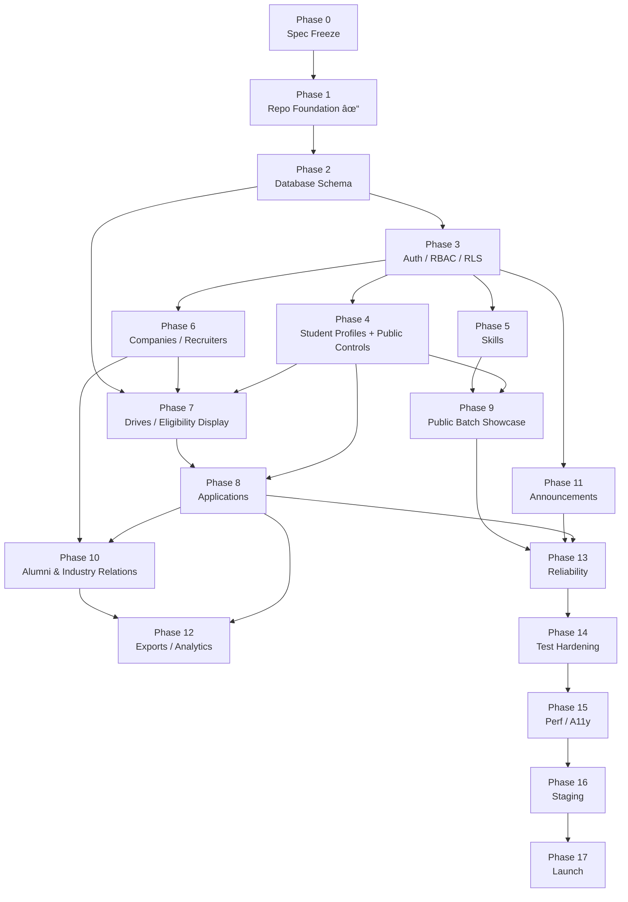

# TNP Portal — Architecture Addendum 1

## Department of Architecture & Planning, VNIT Nagpur
### Training & Placement Portal

**Addendum Version:** A1.0
**Date:** 2026-10-18
**Status:** APPROVED — A1.0 COMPLETE
**Base Document:** `ARCHITECTURE.md` v1.0 (APPROVED — PHASE 0 COMPLETE)
**Scope:** Public Batch Showcase, Alumni Lifecycle, Placement History Retention, Privacy Model, Revised Roadmap

> [!IMPORTANT]
> This addendum extends ARCHITECTURE.md v1.0. It does not supersede or modify the frozen Phase 0 specification.
> Phase 1 implementation is committed and unchanged.
> This document must be reviewed and approved before Phase 2 begins.
> No application code, migrations, or Phase 2 schema changes exist yet.

---

## Table of Contents

1. [Architecture Sections Changed](#1-architecture-sections-changed)
2. [Public Student Profile Data Model](#2-public-student-profile-data-model)
3. [Alumni Lifecycle Model](#3-alumni-lifecycle-model)
4. [Placement History Retention Model](#4-placement-history-retention-model)
5. [Privacy Model](#5-privacy-model)
6. [Phase 2 Schema Impact Audit](#6-phase-2-schema-impact-audit)
7. [Revised Phase 0–17 Roadmap](#7-revised-phase-017-roadmap)
8. [New Product Decisions Requiring Approval](#8-new-product-decisions-requiring-approval)

---

## 1. Architecture Sections Changed

The following sections of `ARCHITECTURE.md` v1.0 are **extended** (not replaced) by this addendum.

| Section | Change Type | Summary |
|---|---|---|
| §7 Database Schema | Additive | New tables: `public_student_profiles`, `alumni_profiles`, `alumni_employment_history`. Additive columns on `student_profiles`. |
| §8 Critical Database Constraints | Additive | New constraints for slug uniqueness, public visibility toggles, alumni lifecycle integrity. |
| §9 RLS / Security Architecture | Additive | New anonymous-access RLS policies on the narrow public projection view/RPC. |
| §19 Route Map | Additive | New public routes `/students`, `/students/[batch]`, `/students/profile/[slug]`. Future alumni routes. |
| §25 Roadmap | Renumbered + Extended | Phases 9–15 renumbered to 11–17. New Phase 9 (Public Batch Showcase) and Phase 10 (Alumni & Industry Relations) inserted before announcements. |
| §26 Phase Dependencies | Updated | New nodes and edges for Phases 9 and 10. |
| §28 Resolved Decisions | Extended | New decisions A1-Q1 through A1-Q6 added for approval (see §8 below). |
| §29 What Should NOT Be Built | Additive | Clarifications on Phase 9/10 scope exclusions. |

> [!NOTE]
> `ARCHITECTURE.md` v1.0 remains intact and authoritative for all Phase 2 through Phase 8 decisions. This addendum is a forward extension, not a replacement.

---

## 2. Public Student Profile Data Model

### 2.1 Design Principles

Public-facing student profiles are architecturally separate from the operational `student_profiles` table. The public projection must:

- Never query `student_profiles`, `academic_records`, `applications`, or `documents` directly from anonymous browser contexts.
- Be served through a dedicated narrow view, RPC, or materialized structure.
- Expose only fields that have been **explicitly opted into** by the student.
- Never expose CGPA, active backlogs, phone, institutional email, application history, rejection/selection details, internal notes, or verification metadata.

### 2.2 Additive Columns on `student_profiles`

The following columns are added to the existing `student_profiles` table schema. They introduce public-facing controls without disrupting any operational schema. All default to **private** (off), requiring deliberate student opt-in.

```sql
-- Additive columns on existing student_profiles table (Phase 9 migration)
ALTER TABLE student_profiles ADD COLUMN
  public_profile_enabled  BOOLEAN NOT NULL DEFAULT false,
  public_resume_enabled   BOOLEAN NOT NULL DEFAULT false,
  public_portfolio_enabled BOOLEAN NOT NULL DEFAULT false,
  public_profile_slug     TEXT UNIQUE,               -- URL-safe, student-chosen or auto-generated
  public_headline         TEXT,                      -- Short professional headline/bio (public)
  public_tagline          TEXT;                      -- One-line summary for card display (public)
```

**Slug Constraints:**
- URL-safe: `[a-z0-9][a-z0-9\-]{2,62}` (regex enforced via CHECK constraint).
- Globally unique across all students.
- Cannot be changed more than once per [decision A1-Q4] days to prevent redirect abuse.
- Students without a slug cannot have a public profile enabled.

**Constraint:**

```sql
ALTER TABLE student_profiles ADD CONSTRAINT chk_slug_format
  CHECK (public_profile_slug ~ '^[a-z0-9][a-z0-9\-]{2,62}$');

ALTER TABLE student_profiles ADD CONSTRAINT chk_public_requires_slug
  CHECK (
    (public_profile_enabled = false)
    OR (public_profile_enabled = true AND public_profile_slug IS NOT NULL)
  );

CREATE UNIQUE INDEX uq_public_profile_slug
  ON student_profiles (public_profile_slug)
  WHERE public_profile_slug IS NOT NULL;
```

### 2.3 Public Projection View / RPC

Anonymous access to student data must go through a dedicated narrow structure. Three options are presented; the decision on which to use is a product decision (A1-Q2).

**Option A — PostgreSQL View (`public_student_profiles_view`):**

```sql
CREATE VIEW public_student_profiles_view AS
SELECT
  sp.public_profile_slug        AS slug,
  p.display_name                AS name,
  ap.display_name               AS program_name,
  ar.batch                      AS graduation_batch,
  sp.public_headline            AS headline,
  sp.public_tagline             AS tagline,
  sp.profile_photo_path         AS photo_path,
  sp.portfolio_url              AS portfolio_url,         -- only if public_portfolio_enabled = true
  sp.linkedin_url               AS linkedin_url,
  sp.public_portfolio_enabled   AS portfolio_available,
  -- Verified skills: only VERIFIED skill names and categories
  -- (joined, never raw proficiency or evidence)
  -- resolved at query time or via separate RPC
  p.id                          AS profile_id,            -- needed for skills join; never returned to client raw
  sp.public_resume_enabled      AS resume_available
FROM student_profiles sp
JOIN profiles p         ON p.id = sp.profile_id AND p.is_active = true
JOIN academic_records ar ON ar.profile_id = sp.profile_id
JOIN academic_programs ap ON ap.id = ar.program_id
WHERE sp.public_profile_enabled = true
  AND sp.public_profile_slug IS NOT NULL;
```

> [!CAUTION]
> `portfolio_url` must only be returned when `public_portfolio_enabled = true`. This is best enforced at the RPC layer (Option B/C) rather than a view column, as a view cannot conditionally null columns based on other columns of the same row without a CASE expression. If Option A is used, the conditional logic must live in the view itself using CASE.

**Option B (Recommended) — SECURITY DEFINER RPC `get_public_student_profile(p_slug TEXT)`:**

A dedicated RPC accepting only a slug, returning a narrow typed composite. Identity is not derived from `auth.uid()` (public route). The function performs all conditional privacy checks internally and returns `NULL` for fields not enabled by the student.

```sql
CREATE OR REPLACE FUNCTION get_public_student_profile(p_slug TEXT)
RETURNS TABLE (
  slug                TEXT,
  name                TEXT,
  program_name        TEXT,
  graduation_batch    TEXT,
  headline            TEXT,
  tagline             TEXT,
  photo_path          TEXT,
  linkedin_url        TEXT,
  portfolio_url       TEXT,     -- NULL unless public_portfolio_enabled = true
  portfolio_available BOOLEAN,
  resume_available    BOOLEAN,
  verified_skills     JSONB     -- [{name, category}] only VERIFIED skills
)
LANGUAGE plpgsql SECURITY DEFINER STABLE
SET search_path = public, pg_temp
AS $$
BEGIN
  RETURN QUERY
  SELECT
    sp.public_profile_slug,
    p.display_name,
    ap.display_name,
    ar.batch,
    sp.public_headline,
    sp.public_tagline,
    sp.profile_photo_path,
    sp.linkedin_url,
    CASE WHEN sp.public_portfolio_enabled THEN sp.portfolio_url ELSE NULL END,
    sp.public_portfolio_enabled,
    sp.public_resume_enabled,
    (
      SELECT jsonb_agg(jsonb_build_object('name', sk.name, 'category', sk.category))
      FROM student_skills ss
      JOIN skills sk ON sk.id = ss.skill_id
      WHERE ss.student_id = p.id
        AND ss.is_active = true
        AND ss.verification_status = 'VERIFIED'
    )
  FROM student_profiles sp
  JOIN profiles p          ON p.id = sp.profile_id AND p.is_active = true
  JOIN academic_records ar  ON ar.profile_id = sp.profile_id
  JOIN academic_programs ap ON ap.id = ar.program_id
  WHERE sp.public_profile_slug = p_slug
    AND sp.public_profile_enabled = true;
END;
$$;

-- Revoke from PUBLIC; grant to anon so unauthenticated callers can execute
REVOKE ALL ON FUNCTION get_public_student_profile(TEXT) FROM PUBLIC;
GRANT EXECUTE ON FUNCTION get_public_student_profile(TEXT) TO anon;
```

**Option C — `get_public_batch_page(p_program_code TEXT, p_batch TEXT, pagination params)` RPC:**

A dedicated paginated RPC for the batch directory page, returning profile cards for a given program+batch combination. Enforces the same narrow projection. Supports bounded server-side filtering.

### 2.4 Public Batch Directory — Proposed Routes

| Route | Description | Auth Required |
|---|---|---|
| `/students` | Landing page — lists all active batches and program directories | None |
| `/students/[batch]` | Batch page — profile cards for students with `public_profile_enabled = true` in that graduation batch | None |
| `/students/profile/[slug]` | Individual public student profile | None |

> [!IMPORTANT]
> These routes **only exist after Phase 9**. They must not be created in Phase 1 or Phase 2. The Phase 1 static page list is unchanged.

**Batch Page Filtering (Server-Side, Bounded):**

Future filtering on `/students/[batch]` will be achievable without search infrastructure because:
- `academic_records.program_id` and `academic_records.batch` already exist.
- `student_skills.skill_id` + `skills.name` already exist with verified status.
- `student_profiles.public_portfolio_enabled` and `public_profile_enabled` already exist.

No full-text search, Elasticsearch, or additional infrastructure is required in Phase 9. Bounded filter parameters (`?program=BARCH&skills=revit`) resolve to SQL `WHERE` clauses using existing indexed columns.

### 2.5 Never Exposed via Public Routes

The following fields and tables must **never** appear in anonymous query responses, views, or RPC return values:

| Data | Why Excluded |
|---|---|
| `academic_records.cgpa` | Academic PII — eligibility-sensitive |
| `academic_records.active_backlogs` | Academic PII — eligibility-sensitive |
| `academic_records.verification_status` | Internal operational metadata |
| `student_profiles.phone` | Personal contact data |
| `student_profiles.other_links` | Not individually visibility-controlled |
| `profiles.avatar_url` (direct) | Use via signed URL only; storage path never exposed raw |
| Institutional email | Not part of professional showcase |
| `applications.*` | Application history is strictly private |
| `application_status_history.*` | Internal pipeline detail |
| `documents.storage_path` | Storage paths are private; signed URLs only |
| `student_skills.proficiency_level` | Operational data; public projection shows name/category only |
| `student_skill_evidence.*` | Internal submission records |

---

## 3. Alumni Lifecycle Model

### 3.1 Design Principle: Preserve Identity, Extend Don't Copy

The preferred approach is **not** to copy student records into an alumni table upon graduation. Instead:

- The original `profiles` record, `student_profiles`, `academic_records`, `documents`, `applications`, and `application_status_history` rows are **retained unchanged** as permanent institutional history.
- The student's Supabase Auth account may remain (for portal access to their own history) or be deprioritized operationally but not deleted.
- An `alumni_profiles` extension record is **attached** to the existing `profiles.id`, adding alumni-specific professional information without duplicating or migrating base records.

This avoids destructive migration, prevents data duplication, and preserves referential integrity of all placement and application history.

### 3.2 Student → Alumni Lifecycle (Three Explicit States)

The lifecycle is modelled as **three separate states** attached to the same `profiles` identity. Authentication account activity, student operational privileges, and alumni status are never conflated.



**Key invariants — A1-Q1 RESOLVED:**

- **The same `profiles.id` is never replaced, copied, or migrated.** The auth account, all applications, all academic records, all audit evidence, and all placement history remain attached to the same identity.
- **Graduation does NOT automatically deactivate the auth account or the Supabase Auth user.** Auth account activity is separated from student operational status.
- **Placement privileges end at graduation** (`STUDENT_GRADUATED`). Middleware checks `student_lifecycle_status`, not just `is_active`, to gate student-only features.
- **Alumni portal access is enabled independently** (`ALUMNI`) when an `alumni_profiles` row is created for that identity, either by staff or (in a future self-service flow) by the alumnus.
- **`profiles.is_active`** is reserved for security-level suspension (account ban, suspected compromise, admin-disabled). It is **not** the graduation trigger.
- Historical applications, placement outcomes, academic references, and audit evidence remain **unchanged** at every lifecycle state change.

### 3.3 New Table: `alumni_profiles`

```sql
CREATE TABLE alumni_profiles (
  id               UUID PRIMARY KEY DEFAULT gen_random_uuid(),
  profile_id       UUID NOT NULL UNIQUE REFERENCES profiles(id),

  -- Graduation
  graduation_year  INTEGER NOT NULL,                       -- 4-digit year
  program_id       UUID NOT NULL REFERENCES academic_programs(id),

  -- Current Professional Status
  current_organization   TEXT,                            -- employer name (free text OR linked company)
  company_id             UUID REFERENCES companies(id),   -- FK to canonical company if matched
  current_role           TEXT,
  professional_domain    TEXT,                            -- e.g., 'Architectural Practice', 'Urban Planning'
  city                   TEXT,
  country                TEXT NOT NULL DEFAULT 'India',
  linkedin_url           TEXT,

  -- Higher Studies (optional)
  higher_studies_institution  TEXT,
  higher_studies_program      TEXT,
  higher_studies_year_start   INTEGER,

  -- Community Preferences (consent-based)
  willing_to_mentor           BOOLEAN NOT NULL DEFAULT false,
  willing_to_refer            BOOLEAN NOT NULL DEFAULT false,
  willing_to_support_placement BOOLEAN NOT NULL DEFAULT false,

  -- Privacy & Visibility
  public_alumni_enabled        BOOLEAN NOT NULL DEFAULT false,  -- show in public alumni directory (Phase 10)
  consent_recorded_at          TIMESTAMPTZ,                    -- when consent was explicitly given

  -- Data Currency
  last_verified_at   TIMESTAMPTZ,
  last_verified_by   UUID REFERENCES profiles(id),

  created_at         TIMESTAMPTZ NOT NULL DEFAULT now(),
  updated_at         TIMESTAMPTZ NOT NULL DEFAULT now(),

  CONSTRAINT chk_graduation_year
    CHECK (graduation_year BETWEEN 1950 AND (EXTRACT(YEAR FROM now()) + 10)::INTEGER),

  CONSTRAINT chk_consent_for_public
    CHECK (
      (public_alumni_enabled = false)
      OR (public_alumni_enabled = true AND consent_recorded_at IS NOT NULL)
    ),

  CONSTRAINT chk_company_or_org
    -- Either unmatched free-text org or matched company FK; both NULL is valid (between jobs)
    CHECK (
      (company_id IS NULL)
      OR (company_id IS NOT NULL AND current_organization IS NULL)
      -- If FK provided, free text is redundant (name derived from companies table)
    )
);

CREATE INDEX idx_alumni_graduation_year ON alumni_profiles (graduation_year);
CREATE INDEX idx_alumni_company         ON alumni_profiles (company_id) WHERE company_id IS NOT NULL;
CREATE INDEX idx_alumni_public          ON alumni_profiles (graduation_year) WHERE public_alumni_enabled = true;
```

> [!NOTE]
> `company_id` is nullable. If an alumni employer is not in the canonical `companies` table, `current_organization` stores the free-text name and `company_id` remains NULL. This "safe unmatched employer" strategy allows the department to match or link records later without data loss.

### 3.4 New Table: `alumni_employment_history`

```sql
CREATE TABLE alumni_employment_history (
  id               UUID PRIMARY KEY DEFAULT gen_random_uuid(),
  alumni_id        UUID NOT NULL REFERENCES alumni_profiles(id) ON DELETE CASCADE,

  organization     TEXT NOT NULL,                    -- free text
  company_id       UUID REFERENCES companies(id),    -- optional canonical link
  role             TEXT NOT NULL,
  professional_domain TEXT,
  city             TEXT,
  country          TEXT,
  started_at       DATE NOT NULL,
  ended_at         DATE,                             -- NULL = current position
  notes            TEXT,

  created_at       TIMESTAMPTZ NOT NULL DEFAULT now(),

  CONSTRAINT chk_employment_dates
    CHECK (ended_at IS NULL OR ended_at >= started_at)
);

CREATE INDEX idx_employment_alumni  ON alumni_employment_history (alumni_id);
CREATE INDEX idx_employment_company ON alumni_employment_history (company_id) WHERE company_id IS NOT NULL;
```

### 3.5 Alumni ↔ Company Relationship

The relationship between alumni and canonical companies is bidirectional via FK:
- `alumni_profiles.company_id` → current employer (nullable FK).
- `alumni_employment_history.company_id` → historical employer (nullable FK).

**Queries this enables (Phase 10+):**

```sql
-- Which alumni work at this company?
SELECT ap.id, p.display_name, ap.current_role
FROM alumni_profiles ap
JOIN profiles p ON p.id = ap.profile_id
WHERE ap.company_id = $1 AND ap.public_alumni_enabled = true;

-- Which companies have the most department alumni?
SELECT c.name, COUNT(*) AS alumni_count
FROM alumni_profiles ap
JOIN companies c ON c.id = ap.company_id
GROUP BY c.name ORDER BY alumni_count DESC;

-- Alumni who may assist with recruiter connections for a company
SELECT ap.id, p.display_name, ap.willing_to_support_placement
FROM alumni_profiles ap
JOIN profiles p ON p.id = ap.profile_id
WHERE ap.company_id = $1 AND ap.willing_to_support_placement = true;
```

**Unmatched employer strategy:**
- Alumni may enter free-text employer names (`current_organization`) that don't exist in `companies`.
- Department staff can later match these to canonical `companies` records by setting `company_id` and clearing `current_organization`, or keep them unmatched indefinitely.
- Unmatched records never break queries — they are simply excluded from company-linked analytics until matched.

---

### 3.6 Explicit Profile Lifecycle Status — Schema (Phase 2 Addition)

To implement the three-state lifecycle from §3.2 without conflating auth-account state with student operational state, the `profiles` table receives a dedicated lifecycle column. This is a **Phase 2 schema addition** (see §6).

```sql
-- New ENUM type
CREATE TYPE student_lifecycle_status AS ENUM (
  'STUDENT_ACTIVE',    -- currently enrolled; full student portal and placement access
  'STUDENT_GRADUATED', -- completed studies; auth preserved; placement privileges ended; historical data unchanged
  'ALUMNI'             -- alumni_profiles attached; alumni portal access; no student placement access
);

-- Additive column on profiles
ALTER TABLE profiles
  ADD COLUMN student_lifecycle_status student_lifecycle_status;
  -- NULL for non-STUDENT roles (STAFF, SUPER_ADMIN, RECRUITER)
  -- Set to STUDENT_ACTIVE on student account creation

-- Constraint: only STUDENT role profiles may have a lifecycle status
ALTER TABLE profiles ADD CONSTRAINT chk_lifecycle_status_student_only
  CHECK (
    (role = 'STUDENT' AND student_lifecycle_status IS NOT NULL)
    OR (role != 'STUDENT' AND student_lifecycle_status IS NULL)
  );
```

**Middleware gate logic (pseudocode):**

```
if profile.role == STUDENT:
  if lifecycle_status == STUDENT_ACTIVE  → allow full student portal
  if lifecycle_status == STUDENT_GRADUATED → allow read-only history; block drives, applications
  if lifecycle_status == ALUMNI          → allow alumni profile management; block student features
if profile.is_active == false → block all portal access (security suspension)
```

**Lifecycle transitions (staff-initiated):**

| Transition | Trigger | Effect |
|---|---|---|
| `STUDENT_ACTIVE → STUDENT_GRADUATED` | Graduation batch closure by staff | Student placement privileges end; auth account preserved |
| `STUDENT_GRADUATED → ALUMNI` | `alumni_profiles` row created by staff | Alumni portal access enabled; identity preserved |
| Any → `is_active = false` | Security suspension by SUPER_ADMIN | Full portal block; auth account may remain |

> [!IMPORTANT]
> `student_lifecycle_status` transitions must be performed by STAFF or SUPER_ADMIN only — never by the student. They must be audit-logged with reason and actor.

---

## 4. Placement History Retention Model

### 4.1 Principle: Institutional Records Do Not Expire

All placement and application data is institutional evidence and must not be deleted or mutated merely because a student has graduated, become inactive, or been converted to alumni status.

**Permanent retention guarantees:**

| Table | Retention Policy |
|---|---|
| `applications` | Permanent. Never deleted on student graduation or alumni conversion. |
| `application_status_history` | Permanent, append-only. No DELETE policy exists (trigger enforces). |
| `placement_drives` | Permanent after PUBLISHED. ARCHIVED status is the terminal state; no deletion. |
| `academic_records` | Permanent. Preserved post-graduation as historical credential evidence. |
| `student_profiles` | Preserved. `profiles.is_active` may be set false (operationally inactive), but row remains. |
| `audit_logs` | Permanent, append-only. No DELETE policy. |

### 4.2 Statistics Derivable from Historical Data

The following operational statistics are derivable from the authoritative historical schema without any manually editable totals or denormalized counters:

```sql
-- Companies recruiting by year (PLACEMENT drives)
SELECT
  EXTRACT(YEAR FROM pd.published_at) AS year,
  c.name                              AS company,
  COUNT(DISTINCT a.student_id)        AS students_selected
FROM placement_drives pd
JOIN companies c   ON c.id = pd.company_id
JOIN applications a ON a.drive_id = pd.id AND a.status = 'SELECTED'
WHERE pd.drive_type = 'PLACEMENT'
GROUP BY year, c.name;

-- Placement drives by academic year
SELECT
  EXTRACT(YEAR FROM published_at) AS year,
  COUNT(*) FILTER (WHERE drive_type = 'PLACEMENT')   AS placement_drives,
  COUNT(*) FILTER (WHERE drive_type = 'INTERNSHIP')  AS internship_drives
FROM placement_drives
WHERE status != 'DRAFT'
GROUP BY year;

-- Placement conversion rate (applied → selected)
SELECT
  pd.id,
  pd.title,
  COUNT(a.id) FILTER (WHERE a.status != 'WITHDRAWN') AS total_applied,
  COUNT(a.id) FILTER (WHERE a.status = 'SELECTED')   AS total_selected,
  ROUND(
    COUNT(a.id) FILTER (WHERE a.status = 'SELECTED')::NUMERIC /
    NULLIF(COUNT(a.id) FILTER (WHERE a.status != 'WITHDRAWN'), 0) * 100, 2
  ) AS conversion_pct
FROM placement_drives pd
JOIN applications a ON a.drive_id = pd.id
GROUP BY pd.id, pd.title;

-- Repeat recruiters (companies appearing in multiple years)
SELECT c.name, COUNT(DISTINCT EXTRACT(YEAR FROM pd.published_at)) AS years_recruited
FROM placement_drives pd
JOIN companies c ON c.id = pd.company_id
WHERE pd.drive_type = 'PLACEMENT' AND pd.status IN ('CLOSED', 'ARCHIVED')
GROUP BY c.name HAVING COUNT(DISTINCT EXTRACT(YEAR FROM pd.published_at)) > 1;

-- Internship-to-placement conversion (students selected in INTERNSHIP then also in PLACEMENT)
SELECT COUNT(DISTINCT a_p.student_id) AS converted
FROM applications a_i
JOIN placement_drives pd_i ON pd_i.id = a_i.drive_id AND pd_i.drive_type = 'INTERNSHIP'
JOIN applications a_p ON a_p.student_id = a_i.student_id
JOIN placement_drives pd_p ON pd_p.id = a_p.drive_id AND pd_p.drive_type = 'PLACEMENT'
WHERE a_i.status = 'SELECTED' AND a_p.status = 'SELECTED';
```

> [!IMPORTANT]
> No manually editable counter columns (e.g., `placement_rate`, `total_placed`) should exist on any table. All statistics must be derived from authoritative event rows (`applications`, `placement_drives`, `companies`) at query time or via cached views for performance.

### 4.3 Graduated / Inactive Student State

When a student graduates or becomes operationally inactive:
1. `profiles.is_active` → `false` (student no longer logs in for new drives).
2. `student_roster.is_active` → `false` (roster slot closed; email cannot be re-claimed).
3. All `applications`, `application_status_history`, `academic_records`, `student_profiles`, and `documents` rows remain **untouched**.
4. The student's `auth.users` record may be preserved (for historical access) or deprioritized per department policy — but must not be hard-deleted if it would cascade-delete dependent records.
5. An `alumni_profiles` row is created (by staff or self-service) to extend the identity with professional information.

---

## 5. Privacy Model

### 5.1 Four Data Classes — Explicit Visibility and Retention Rules

These four classes have **separate and non-interchangeable** visibility rules and retention obligations. They must never be merged in API responses or access policies.

---

**Class 1 — Public Student Showcase Data**

| Property | Value |
|---|---|
| **Definition** | Fields from `student_profiles` and `academic_records` that a student has **explicitly opted into** making public |
| **Visibility** | Anonymous (unauthenticated) via narrow SECURITY DEFINER RPC only |
| **Access path** | `get_public_student_profile()`, `get_public_batch_page()` — no direct table access |
| **Default** | All fields private by default; student must affirmatively enable |
| **Retention** | Active while student has `public_profile_enabled = true`; disappears from public view if toggled off |
| **Never exposed** | CGPA, backlogs, phone, email, application history, verification status, internal notes |

---

**Class 2 — Private Operational Student Data**

| Property | Value |
|---|---|
| **Definition** | Full student operational record: `student_profiles`, `academic_records`, `student_skills`, `documents`, `applications`, `application_status_history` |
| **Visibility** | Authenticated only: student (own record via `auth.uid()`), staff (scoped by coordinator assignment), SUPER_ADMIN |
| **Access path** | RLS policies on base tables; narrow SECURITY DEFINER procedures for mutations |
| **Default** | Never accessible to anonymous or recruiter roles |
| **Retention** | Preserved permanently; `profiles.student_lifecycle_status` changes do not delete or alter these records |
| **Never exposed** | To anonymous users, recruiters, or other students |

---

**Class 3 — Permanent Historical Placement Records**

| Property | Value |
|---|---|
| **Definition** | Institutional evidence: `applications`, `application_status_history`, `placement_drives`, `academic_records`, `audit_logs` |
| **Visibility** | Full record: staff/admin only. Aggregate summaries: public only where explicitly approved by department |
| **Access path** | Staff: authenticated RLS policies. Public aggregates: SECURITY DEFINER statistics RPC (no individual student data) |
| **Default** | No individual record exposed publicly |
| **Retention** | **Permanent. Never deleted** regardless of graduation, alumni conversion, or auth account state. Append-only for `application_status_history` and `audit_logs` |
| **Never exposed** | Student names, individual packages, CGPA, backlogs, rejection reasons in any public context |

---

**Class 4 — Alumni Professional / Relationship Data**

| Property | Value |
|---|---|
| **Definition** | `alumni_profiles`, `alumni_employment_history`; fields the alumnus has consented to share |
| **Visibility** | Public: only fields enabled by `public_alumni_enabled = true` AND `consent_recorded_at IS NOT NULL`. Internal staff: full record |
| **Access path** | Public: SECURITY DEFINER alumni RPC (Phase 10). Staff: authenticated RLS |
| **Default** | All alumni professional data private until explicit consent |
| **Retention** | Preserved permanently; alumni_profiles may be updated by alumni or staff; employment history is additive |
| **Internal-only fields** | `willing_to_mentor`, `willing_to_refer`, `willing_to_support_placement` — staff-visible only, never in public alumni directory |
| **Never exposed** | Salary, personal phone/email, CGPA, application history, internal TNP notes |

> [!IMPORTANT]
> These four classes must never be merged in any single API response. An RPC returning public showcase data (Class 1) must never include a field from Class 2 or Class 3, even if the database schema technically allows joining them.

---

### 5.2 Student Profile Privacy Controls

| Control | Default | When Student Sets True |
|---|---|---|
| `public_profile_enabled` | `false` | Profile card appears in `/students/[batch]` directory |
| `public_resume_enabled` | `false` | A "Resume Available" indicator appears on public card; no anonymous download |
| `public_portfolio_enabled` | `false` | `portfolio_url` is exposed in public profile |
| `public_profile_slug` | `NULL` | URL `/students/profile/[slug]` becomes accessible |

> [!CAUTION]
> `public_resume_enabled = true` shows only the "Resume Available" indicator. It does **not** grant anonymous resume download. Any future public-resume download mechanism requires a separate explicit privacy decision and protected delivery design (A1-Q5 RESOLVED: V1 shows indicator only).

### 5.3 Alumni Privacy Controls — A1-Q3 RESOLVED

Public alumni fields and internal TNP relationship fields are **strictly separated**.

**Public fields** (visible when `public_alumni_enabled = true` AND `consent_recorded_at IS NOT NULL`):

| Field | Visibility |
|---|---|
| Name | Public |
| Graduation year | Public |
| Academic program | Public |
| Professional domain | Public |
| City / country | Public |
| Current employer name | Public |
| Current role / title | Public |

**Internal TNP relationship fields** (staff-visible only — never in public alumni directory):

| Field | Visibility |
|---|---|
| `willing_to_mentor` | Staff only |
| `willing_to_refer` | Staff only |
| `willing_to_support_placement` | Staff only |
| Personal phone | Never exposed |
| Personal / institutional email | Never exposed |
| Salary / compensation history | Never stored or exposed |
| CGPA / backlog history | Never in alumni context |
| Application pipeline history | Staff only via Class 3 |
| Internal TNP notes | Staff only |

Alumni consent is explicitly recorded (`consent_recorded_at IS NOT NULL`) before any field becomes publicly visible. Consent withdrawal sets `public_alumni_enabled = false`.

### 5.4 Explicit Exclusions from All Public Projections

Regardless of student opt-in, the following must never appear in anonymous API responses:

- CGPA (current or historical snapshot)
- Active or historical backlog count
- Phone number
- Institutional email or personal email
- Internal verification status of academic records
- Application status (APPLIED, SHORTLISTED, REJECTED, SELECTED, etc.)
- Drive names/companies applied to
- Resume file (storage path or signed URL) via anonymous access
- Rejection reasons or selection criteria
- Internal staff notes
- Audit log entries
- Raw `profile_id` UUIDs (use slug for public identity)

### 5.5 Anonymous RLS Policy for Public Projection

The public batch directory is served via `anon` role through the narrow RPC (§2.3). No direct `SELECT` on `student_profiles`, `academic_records`, or `profiles` is granted to `anon`.

```sql
-- student_profiles: no anonymous SELECT on base table
-- All anonymous access goes through get_public_student_profile() RPC
-- RLS on student_profiles for anon: deny
CREATE POLICY "anon_deny_student_profiles"
  ON student_profiles FOR SELECT TO anon
  USING (false);  -- explicitly deny; anon must use RPC only

-- academic_records: no anonymous SELECT
CREATE POLICY "anon_deny_academic_records"
  ON academic_records FOR SELECT TO anon
  USING (false);

-- documents: no anonymous SELECT
CREATE POLICY "anon_deny_documents"
  ON documents FOR SELECT TO anon
  USING (false);

-- applications: no anonymous SELECT
CREATE POLICY "anon_deny_applications"
  ON applications FOR SELECT TO anon
  USING (false);
```

---

## 6. Phase 2 Schema Impact Audit

### 6.1 Decision Matrix

Phase 2 builds the foundational schema. This audit identifies exactly what belongs in Phase 2, what belongs in Phase 9/10, and what must be designed carefully now to avoid future destructive redesign.

| Item | Include in Phase 2? | Rationale |
|---|---|---|
| Core tables as in ARCHITECTURE.md v1.0 §7 | **Yes — unchanged** | All 20 existing tables are correct. |
| `student_lifecycle_status` ENUM type + column on `profiles` | **Yes — add column, default STUDENT_ACTIVE for STUDENT role** | Required by A1-Q1 to gate student vs. alumni portal access without conflating auth-account state. Cheaper to add to an empty profiles table. |
| `public_profile_enabled` on `student_profiles` | **Yes — add column, default false** | Low cost; avoids Phase 9 ALTER modifying a heavily-used table. |
| `public_resume_enabled` on `student_profiles` | **Yes — add column, default false** | Same rationale. |
| `public_portfolio_enabled` on `student_profiles` | **Yes — add column, default false** | Same rationale. |
| `public_profile_slug` on `student_profiles` | **Yes — add column, NULL by default, UNIQUE index** | Slug uniqueness constraint is easier to add when table is empty; avoids future backfill. |
| `public_headline` / `public_tagline` on `student_profiles` | **Yes — add columns, NULL by default** | Low cost; student-writable professional fields. |
| `get_public_student_profile()` RPC | **No — Phase 9 only** | No public pages exist in Phase 2; premature to deploy. |
| `anon` RLS deny policies | **No — Phase 9 only** | Anon access is not activated until public batch pages launch. |
| `/students/*` routes | **No — Phase 9 only** | No public student directory in Phase 2–8. |
| `alumni_profiles` table | **No — Phase 10 only** | No students graduating yet; premature. |
| `alumni_employment_history` table | **No — Phase 10 only** | Same. |
| Alumni FK on `companies` | **No — Phase 10 only** | Additive FK migration in Phase 10 is safe. |
| Public alumni RLS | **No — Phase 10 only** | |
| Historical statistics views | **No — Phase 10 only** | Queries work on existing tables once data exists. |

### 6.2 Phase 2 Schema Delta (vs ARCHITECTURE.md v1.0)

Phase 2 should include the following **additions** beyond the original §7 schema:

```sql
-- ADDITION 1: student_lifecycle_status ENUM (A1-Q1)
CREATE TYPE student_lifecycle_status AS ENUM (
  'STUDENT_ACTIVE',    -- enrolled; full placement access
  'STUDENT_GRADUATED', -- graduated; auth preserved; placement privileges ended
  'ALUMNI'             -- alumni_profiles attached; alumni portal access enabled
);

-- Additive column on profiles
ALTER TABLE profiles
  ADD COLUMN student_lifecycle_status student_lifecycle_status;

-- Constraint: lifecycle status valid only for STUDENT role
ALTER TABLE profiles ADD CONSTRAINT chk_lifecycle_status_student_only
  CHECK (
    (role = 'STUDENT' AND student_lifecycle_status IS NOT NULL)
    OR (role != 'STUDENT' AND student_lifecycle_status IS NULL)
  );

-- ADDITION 2: Public showcase fields on student_profiles
ALTER TABLE student_profiles ADD COLUMN
  public_profile_enabled   BOOLEAN NOT NULL DEFAULT false,
  public_resume_enabled    BOOLEAN NOT NULL DEFAULT false,
  public_portfolio_enabled BOOLEAN NOT NULL DEFAULT false,
  public_profile_slug      TEXT,
  public_headline          TEXT,
  public_tagline           TEXT;

ALTER TABLE student_profiles ADD CONSTRAINT chk_slug_format
  CHECK (public_profile_slug ~ '^[a-z0-9][a-z0-9\-]{2,62}$');

ALTER TABLE student_profiles ADD CONSTRAINT chk_public_requires_slug
  CHECK (
    (public_profile_enabled = false)
    OR (public_profile_enabled = true AND public_profile_slug IS NOT NULL)
  );

CREATE UNIQUE INDEX uq_public_profile_slug
  ON student_profiles (public_profile_slug)
  WHERE public_profile_slug IS NOT NULL;
```

**Why include these in Phase 2 and not a later phase:**
- `student_lifecycle_status` must be in Phase 2 because it affects the `profiles` table that is created in Phase 2. Adding it in Phase 3 would require an ALTER on a table that already has RLS applied.
- The `UNIQUE` index on `slug` is trivially cheaper to apply to an empty table.
- All public-showcase columns default to `false` or `NULL`; they are invisible and inactive until Phase 9 activates the public routes.
- `lifecycle_status` column defaults are applied via a trigger or application logic on student creation; non-STUDENT profiles leave it NULL.

### 6.3 Updated Phase 2 Deliverables Table

Phase 2 deliverables from ARCHITECTURE.md §25 Phase 2 are amended as follows:

> **Original:** "All 20 tables per Section 7 (including `student_skills` with atomic 15-claim cap trigger)"
> **Amended:** "All 20 tables per Section 7 + `student_lifecycle_status` ENUM and column on `profiles` (A1-Q1) + public-profile privacy columns on `student_profiles` (Addendum A1 §6.2). Total: 20 tables with augmented schemas on `profiles` and `student_profiles`."

All other Phase 2 deliverables remain unchanged.

### 6.4 What Phase 2 Must NOT Pre-Build

Phase 2 must not include:
- The `get_public_student_profile()` or `get_public_batch_page()` RPC functions.
- Anonymous RLS policies or `anon` GRANT statements.
- The `alumni_profiles` or `alumni_employment_history` tables.
- Any Next.js routes under `/students/*`.
- Any alumni-related UI or server actions.

Premature construction of these features would require lifecycle management (e.g., maintaining RPC contracts across migrations) before there is any operational need.

---

## 7. Revised Phase 0–17 Roadmap

### Summary of Changes

| Original Phase | Original Title | New Number | Change |
|---|---|---|---|
| Phase 0 | Specification Freeze | Phase 0 | Unchanged |
| Phase 1 | Repository Foundation | Phase 1 | **COMPLETE** |
| Phase 2 | Database Schema | Phase 2 | +Schema additions from §6 |
| Phase 3 | Authentication / RBAC / RLS | Phase 3 | Unchanged |
| Phase 4 | Student Profiles / Resume | Phase 4 | +public-profile field management UI |
| Phase 5 | Student Skills | Phase 5 | Unchanged |
| Phase 6 | Companies / Recruiters | Phase 6 | Unchanged |
| Phase 7 | Drives / Eligibility Display | Phase 7 | Unchanged |
| Phase 8 | Applications / Selection | Phase 8 | Unchanged |
| (new) | Public Batch Showcase | **Phase 9** | NEW |
| (new) | Alumni & Industry Relations | **Phase 10** | NEW |
| Phase 9 (old) | Announcements | **Phase 11** | Renumbered |
| Phase 10 (old) | Exports / Basic Analytics | **Phase 12** | Renumbered |
| Phase 11 (old) | Reliability / Errors | **Phase 13** | Renumbered |
| Phase 12 (old) | Test Hardening | **Phase 14** | Renumbered |
| Phase 13 (old) | Performance / Accessibility | **Phase 15** | Renumbered |
| Phase 14 (old) | Staging / Deployment | **Phase 16** | Renumbered |
| Phase 15 (old) | Controlled Production Launch | **Phase 17** | Renumbered |

---

### Phase 0 — Specification Freeze
**Status:** COMPLETE / FROZEN.

---

### Phase 1 — Repository Foundation
**Status:** COMPLETE. Committed at `e451a9bc1a17fcb91efd39d3a371f1b3e0b93298`.

---

### Phase 2 — Database Schema / Migrations
**Objective:** Complete, tested schema. All tables, constraints, triggers, SECURITY DEFINER functions.
**Deliverables:**
- All items from ARCHITECTURE.md §25 Phase 2.
- **Additional (Addendum A1):** Public-profile privacy columns on `student_profiles` per §6.2 of this addendum. All default to `false` / `NULL`. No public routes or anon grants in this phase.

**Exit:** `supabase db reset` clean; all tables/constraints/triggers verified; seed data loads; `public_profile_slug` UNIQUE index confirmed.

---

### Phase 3 — Authentication / RBAC / RLS
**Objective:** All auth flows; RLS enforced; middleware routing; Super Admin bootstrapped.
**Deliverables:** Unchanged from ARCHITECTURE.md §25 Phase 3.
**Note:** RLS for `anon` on student tables (deny policies) not activated in this phase; anon public routes don't exist yet.

---

### Phase 4 — Student Profiles / Resume
**Objective:** Student profile management; academic verification; resume upload.
**Deliverables (additions from Addendum A1):**
- Student UI to manage public-profile fields: `public_profile_enabled`, `public_resume_enabled`, `public_portfolio_enabled`, `public_profile_slug`, `public_headline`, `public_tagline`.
- `update_student_profile()` procedure amended to accept these fields.
- Slug auto-generation or manual entry with format validation.
- Preview of public profile card (shows what the public will see — navigates to inactive `/students/profile/[slug]` placeholder that renders 404 until Phase 9 activates routes).

**Exit:** All original Phase 4 exits + student can enable/disable public profile flags and set a slug.

---

### Phase 5 — Student Skills & Bounded Administration
**Objective:** Full skill lifecycle; coordinator scope enforcement.
**Deliverables:** Unchanged from ARCHITECTURE.md §25 Phase 5.

---

### Phase 6 — Companies / Recruiters
**Objective:** Company management; recruiter invitation workflow.
**Deliverables:** Unchanged from ARCHITECTURE.md §25 Phase 6.

---

### Phase 7 — Drives / Eligibility (Display Only)
**Objective:** Drive lifecycle management; student eligibility display. No apply action.
**Deliverables:** Unchanged from ARCHITECTURE.md §25 Phase 7.

---

### Phase 8 — Applications / Selection Pipeline
**Objective:** Complete application workflow from submission through selection and terminal correction.
**Deliverables:** Unchanged from ARCHITECTURE.md §25 Phase 8.

---

### Phase 9 — Public Batch Showcase (NEW)
**Objective:** Public student talent directory organized by academic batch. Individual public professional profiles. Privacy controls active.
**Deliverables:**
- `get_public_student_profile(slug)` SECURITY DEFINER RPC.
- `get_public_batch_page(program_code, batch, pagination)` SECURITY DEFINER RPC.
- Anonymous RLS deny policies on `student_profiles`, `academic_records`, `applications`, `documents`.
- `GRANT EXECUTE ON FUNCTION get_public_student_profile TO anon;`
- Public Next.js routes: `/students`, `/students/[batch]`, `/students/profile/[slug]`.
- Server Components for batch directory and individual profile pages (ISR-safe; no sensitive data in Next.js cache).
- Batch page bounded server-side filtering: program, skills, portfolio availability.
- Student UI privacy control in Phase 4 is now functional (public routes exist).
- Staff: admin UI to view which students have public profiles enabled and audit visibility.

**Exit:**
- `/students/profile/[slug]` renders correctly for a student with `public_profile_enabled = true`.
- `/students/[batch]` lists only opted-in students.
- Anonymous user cannot access CGPA, backlogs, applications, or documents via any API route.
- Negative pgTAP tests confirm `anon` cannot SELECT from base tables.
- All filtering parameters produce bounded, deterministic SQL queries.

---

### Phase 10 — Alumni & Industry Relations (NEW)
**Objective:** Alumni profiles, employment history, alumni-company connections, mentorship/referral/placement preferences, alumni directory.
**Deliverables:**
- `alumni_profiles` table migration.
- `alumni_employment_history` table migration.
- Admin UI: staff-initiated alumni profile creation on student graduation.
- Alumni self-update flow (if authenticated alumni portal access is preserved; per A1-Q1).
- Company-alumni linkage: match free-text `current_organization` to canonical `companies.id`.
- Alumni directory: public route `/alumni` (if `public_alumni_enabled = true` and A1-Q3 decisions resolved).
- Mentorship/referral/placement-support preference management (staff-visible, not necessarily public).
- Staff analytics: alumni by company, alumni by graduation year, alumni outreach candidates.

**Exit:**
- Alumni profile creation workflow complete.
- Company linkage functional.
- If public alumni directory approved: `/alumni` renders opted-in alumni with correct field visibility.
- Historical `applications` and `academic_records` remain unmodified after alumni conversion.

---

### Phase 11 — Announcements *(was Phase 9)*
**Objective:** Simple announcement system with audience targeting.
**Deliverables:** Unchanged from original Phase 9.
**Effort:** 2–3 days
**Exit:** Staff publishes; students/recruiters see targeted announcements.

---

### Phase 12 — Exports / Basic Analytics *(was Phase 10)*
**Objective:** Bounded exports; operational statistics.
**Deliverables (additions from Addendum A1):**
- Placement statistics derived from authoritative historical data (no manually editable totals).
- Aggregate views: drives by year, conversion rates, repeat recruiters, internship-to-placement conversion.
- Alumni industry analytics if Phase 10 complete.

**Effort:** 3–4 days
**Exit:** Secretary exports bounded dataset; stats display; exports audit-logged.

---

### Phase 13 — Reliability / Errors / Audit Refinement *(was Phase 11)*
**Objective:** Production-hardened error handling; complete audit coverage.
**Deliverables:** Unchanged from original Phase 11.
**Effort:** 3–4 days

---

### Phase 14 — Test Hardening *(was Phase 12)*
**Objective:** Comprehensive test suites passing in CI.
**Deliverables (additions from Addendum A1):**
- Negative pgTAP tests confirming `anon` cannot access student PII from base tables.
- RPC tests confirming `get_public_student_profile()` returns correct null-field behavior per privacy flags.
- Alumni lifecycle integration tests.

**Effort:** 5–7 days

---

### Phase 15 — Performance / Accessibility / Responsive *(was Phase 13)*
**Objective:** Production-quality UX.
**Deliverables:** Unchanged from original Phase 13.
**Effort:** 3–4 days

---

### Phase 16 — Staging / Deployment / Monitoring *(was Phase 14)*
**Objective:** Verified production deployment procedure.
**Deliverables:** Unchanged from original Phase 14.
**Effort:** 2–3 days

---

### Phase 17 — Controlled Production Launch *(was Phase 15)*
**Objective:** Live system; first users onboarded.
**Deliverables:** Unchanged from original Phase 15.
**Effort:** 1–2 days

---

### Updated Phase Dependency Graph



---

## 8. Product Decisions — All RESOLVED

All A1-Q1 through A1-Q6 decisions are resolved. Phase 9 and Phase 10 may proceed as scheduled without reopening these questions unless explicitly requested.

---

### A1-Q1 — Alumni Auth Account Lifecycle ✅ RESOLVED

**Final Decision:** Preserve the same `profiles` identity throughout the full student → graduated → alumni lifecycle. Do not automatically deactivate the Supabase Auth account or profile identity at graduation.

**Explicit separation of three orthogonal states:**

| State | Column | Meaning |
|---|---|---|
| **Authentication activity** | Supabase Auth account + `profiles.is_active` | Whether the person can authenticate at all. `is_active = false` = security suspension only. |
| **Student operational status** | `profiles.student_lifecycle_status` | Whether student placement privileges are active (`STUDENT_ACTIVE`), ended (`STUDENT_GRADUATED`), or transitioned to alumni (`ALUMNI`). |
| **Alumni status** | Presence of `alumni_profiles` row | Whether an alumni professional record is attached to this identity. |

**Lifecycle transitions:**
- On graduation: `student_lifecycle_status → STUDENT_GRADUATED`. Auth account preserved. Student placement privileges end. Historical records unchanged.
- On alumni profile creation: `student_lifecycle_status → ALUMNI`. Alumni may authenticate and manage their professional information in the alumni portal.
- The same `profiles.id` is never replaced, copied, or migrated.

**Schema impact (Phase 2):** `student_lifecycle_status` ENUM and additive column on `profiles` — see §3.6 and §6.2.

---

### A1-Q2 — Public Profile Serving Mechanism ✅ RESOLVED

**Final Decision:** SECURITY DEFINER RPC only.

- Anonymous users receive access exclusively through `get_public_student_profile(p_slug)` and `get_public_batch_page(...)` functions.
- No direct `SELECT` on `student_profiles`, `academic_records`, `applications`, or `documents` is granted to `anon`.
- The RPC encapsulates all privacy checks (visibility flags, field nullification) as database logic — not application code.
- `anon` role has only `EXECUTE` on the approved public RPCs. Never `SELECT` on any base table used for operational student data.

---

### A1-Q3 — Alumni Profile Public Visibility Granularity ✅ RESOLVED

**Final Decision:** The following fields may be publicly visible when explicitly enabled by the alumnus (`public_alumni_enabled = true` AND `consent_recorded_at IS NOT NULL`):

| Field | Public when consented |
|---|---|
| Name | ✅ |
| Graduation year | ✅ |
| Academic program | ✅ |
| Professional domain | ✅ |
| City / country | ✅ |
| Current employer name | ✅ |
| Current role / title | ✅ |

**Strictly internal — never public:**

- Personal phone, personal/institutional email
- Salary or compensation history
- CGPA, backlogs, application history
- Internal TNP notes
- `willing_to_mentor`, `willing_to_refer`, `willing_to_support_placement` — staff-visible only

**Separation enforced:** Public alumni visibility and internal TNP relationship management fields are stored and accessed through separate policies. The public alumni RPC returns only consented public fields; staff-facing views include the relationship preference fields. These are never returned in the same response.

---

### A1-Q4 — Public Profile Slug Change Policy ✅ RESOLVED

**Final Decision:** Slug is **immutable once assigned** during normal student use. This is not a student-editable field after initial assignment.

**Exception — Super Admin recovery path:**
A protected, audited Super Admin procedure (`admin_reassign_profile_slug`) is available for:
- Typo correction (within 30 days of first assignment)
- Legal or name correction
- Collision recovery (slug assigned to a deactivated profile)

Requirements for the Super Admin recovery path:
- Executable only by `SUPER_ADMIN` role
- Requires an explicit written reason recorded in `audit_logs`
- Must NOT be accessible via any student-facing or staff-facing UI
- Must be an internal DB procedure or operator CLI command only

The old slug is retired (not recycled to another profile) to prevent broken links from being claimed.

---

### A1-Q5 — Public Resume Download Mechanism ✅ RESOLVED

**Final Decision:** V1 public profile shows "Resume Available" indicator only. No anonymous resume download.

- `public_resume_enabled = true` sets the indicator visible on the public profile card.
- No signed URL, no downloadable file, no anonymous storage access.
- Resume remains private. Formal recruiter contact through the TNP cell is the institutional access path.
- Any future public-resume access requires a **separate explicit privacy decision and protected delivery design** — it must not be retrofitted onto this flag without architectural review.

---

### A1-Q6 — Batch Directory URL Structure ✅ RESOLVED

**Final Decision:** Use the canonical `batch` field value directly as the URL segment.

- Route: `/students/2022-2027` (using `student_roster.batch` / `academic_records.batch`)
- Program filtering: query parameter (`?program=barch`)
- No artificial numeric IDs in public URLs
- Human-readable batch value already uniquely identifies the cohort

**Route safety constraint:** The `[batch]` dynamic segment must be validated against a whitelist of known batch values retrieved server-side (e.g., `SELECT DISTINCT batch FROM academic_records WHERE public_profile_enabled records exist`). It must not be used as authorization logic — only as a filter parameter. Invalid batch values return 404, not an error revealing schema structure.

---

*End of Architecture Addendum A1.0*
*Status: APPROVED — A1.0 COMPLETE*
*A1-Q1 through A1-Q6: All RESOLVED*
*Next step: Phase 2 — Database Schema / Migrations*