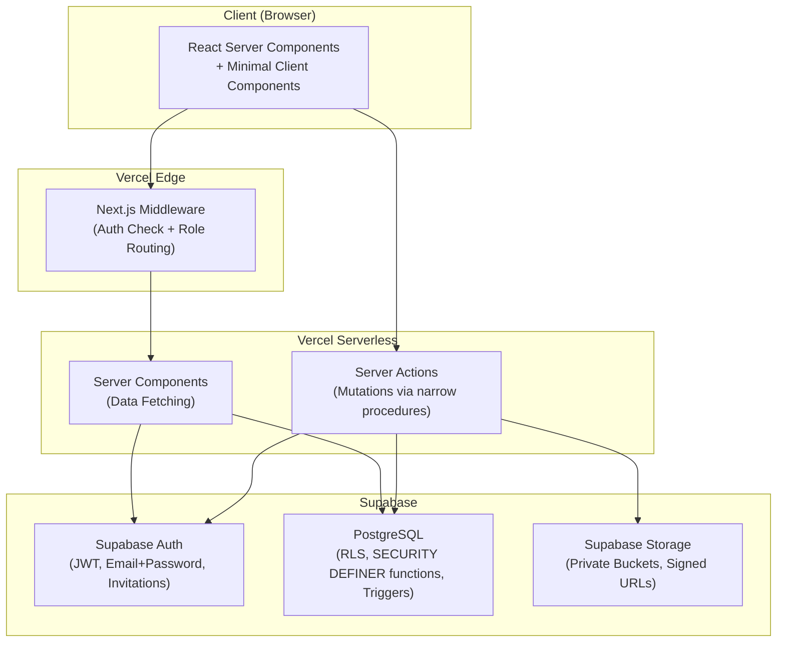
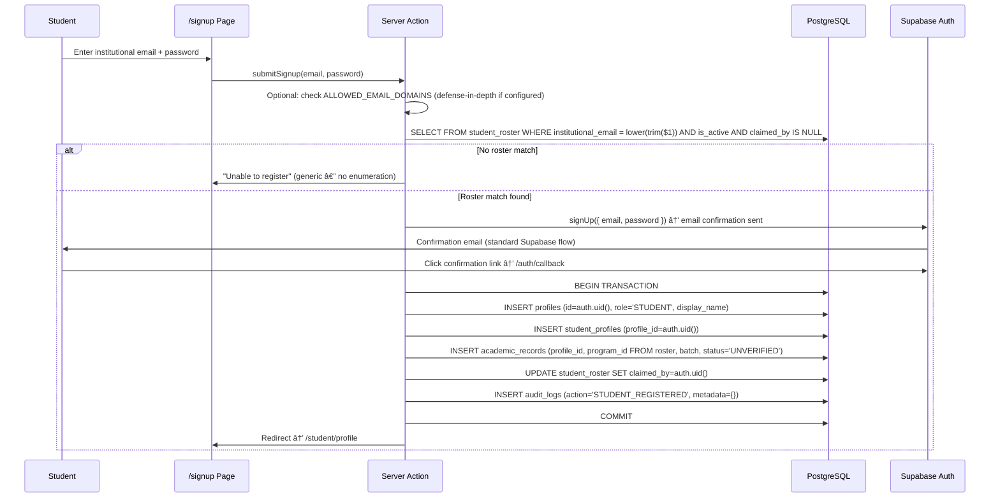
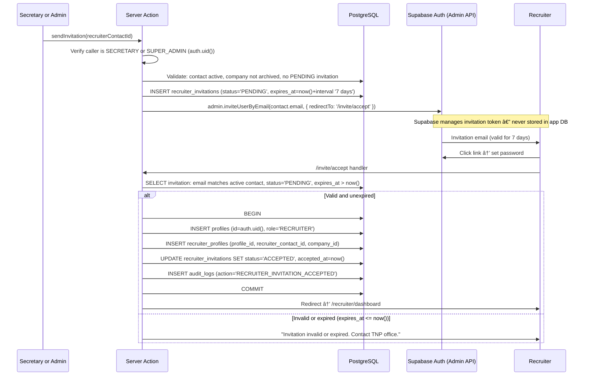
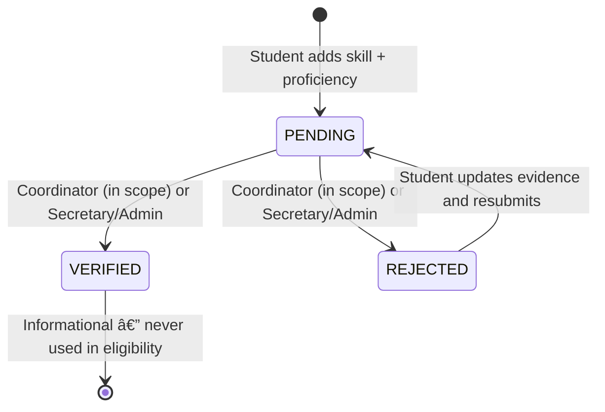
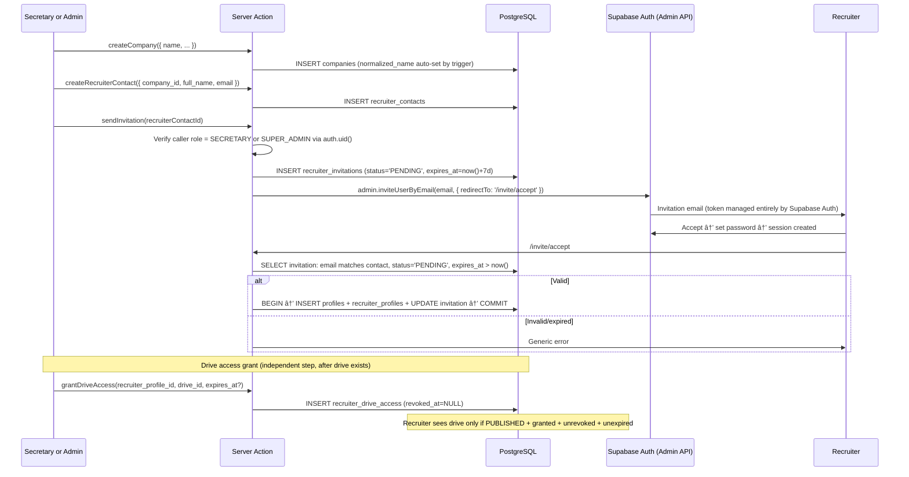
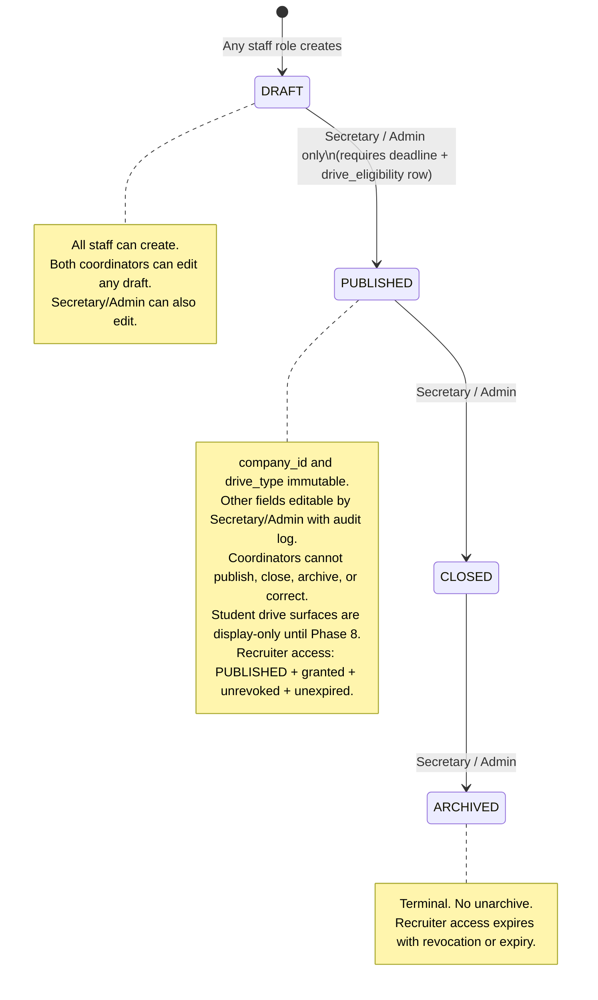
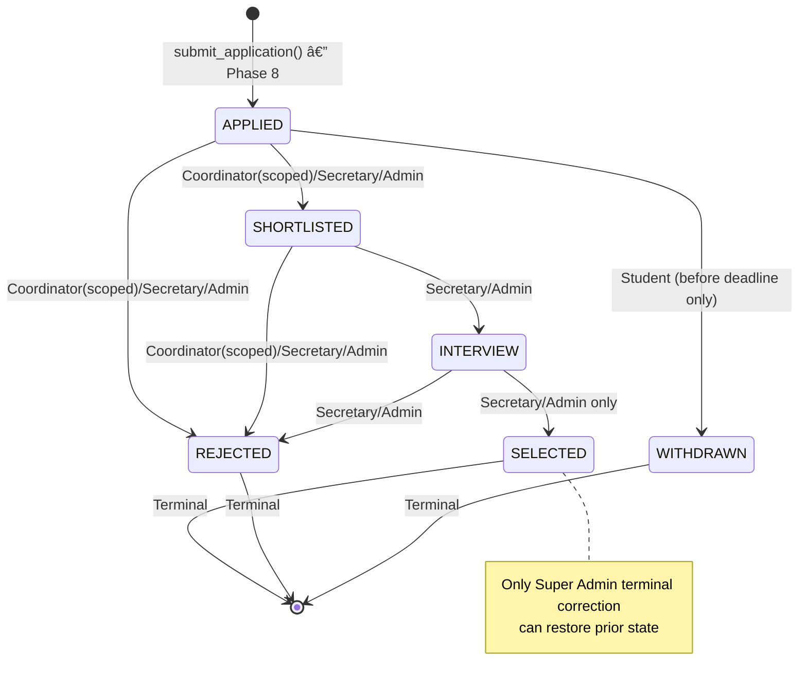
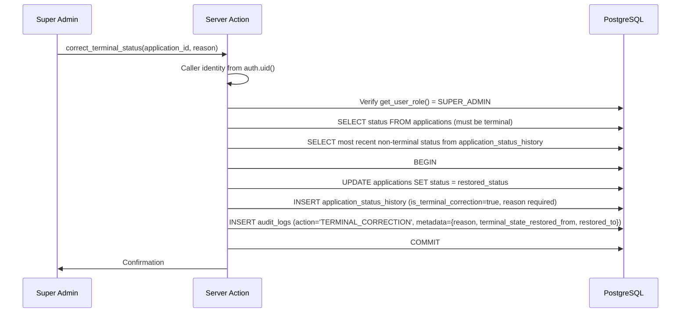
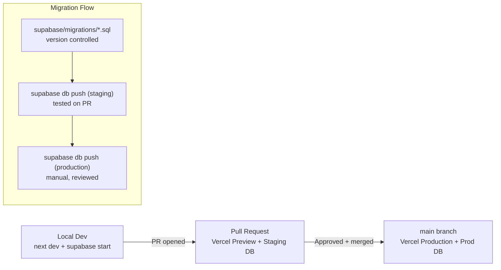
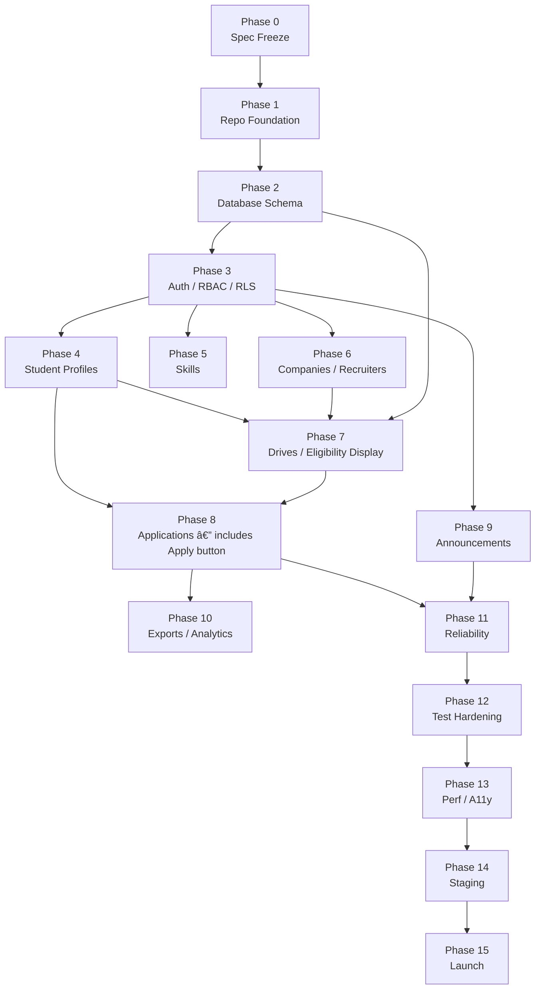

# TNP Portal — Architecture Document

## Department of Architecture & Planning, VNIT Nagpur
### Training & Placement Portal

**Version:** 1.0
**Date:** 2026-10-18
**Status:** APPROVED — PHASE 0 COMPLETE

> [!NOTE]
> This is version 1.0 (Phase 0 Specification Freeze). All architectural requirements, review corrections, and final product decisions (Q1–Q14) have been reconciled and approved. The architecture is locked; Phase 1 implementation may proceed upon instruction.

---

## Table of Contents

1. [Product Architecture](#1-product-architecture)
2. [Directory Structure](#2-directory-structure)
3. [Technology Choices](#3-technology-choices)
4. [Role Hierarchy](#4-role-hierarchy)
5. [Capability Matrix](#5-capability-matrix)
6. [Authentication & Provisioning](#6-authentication--provisioning)
7. [Database Schema](#7-database-schema)
8. [Critical Database Constraints](#8-critical-database-constraints)
9. [RLS / Security Architecture](#9-rls--security-architecture)
10. [Storage Architecture](#10-storage-architecture)
11. [Student-Profile Workflow](#11-student-profile-workflow)
12. [Skills Workflow](#12-skills-workflow)
13. [Company / Recruiter Invitation Workflow](#13-company--recruiter-invitation-workflow)
14. [Drive Lifecycle](#14-drive-lifecycle)
15. [Eligibility Architecture](#15-eligibility-architecture)
16. [Application Workflow](#16-application-workflow)
17. [Terminal-Correction Architecture](#17-terminal-correction-architecture)
18. [Audit Architecture](#18-audit-architecture)
19. [Route Map](#19-route-map)
20. [Pagination / Query Architecture](#20-pagination--query-architecture)
21. [Testing Strategy](#21-testing-strategy)
22. [Deployment Architecture](#22-deployment-architecture)
23. [Performance Strategy](#23-performance-strategy)
24. [Accessibility Strategy](#24-accessibility-strategy)
25. [Phase 0–15 Roadmap](#25-phase-015-roadmap)
26. [Phase Dependencies](#26-phase-dependencies)
27. [Risks & Security Concerns](#27-risks--security-concerns)
28. [Questions Requiring Your Decision](#28-questions-requiring-your-decision)
29. [What Should NOT Be Built](#29-what-should-not-be-built)
30. [Phase 1 Scope](#30-phase-1-scope)
31. [Revision Log](#31-revision-log)

---

## 1. Product Architecture

### High-Level Design

The portal is a **server-first monolithic web application** with three layers:

| Layer | Technology | Responsibility |
|-------|-----------|---------------|
| Presentation | Next.js App Router + Server Components | Rendering, routing, form handling |
| Business Logic | PostgreSQL functions + Server Actions | Eligibility, transitions, validation |
| Data & Auth | Supabase (PostgreSQL, Auth, Storage) | Persistence, RLS, file storage, sessions |

### Architecture Principles

- **Server-first rendering** — Server Components by default; client JS only for interactivity (forms, modals)
- **Database-authoritative** — all business rules (eligibility, status transitions, role cardinality) enforced in PostgreSQL, never duplicated in TypeScript
- **Default-deny security** — RLS enabled on all tables; no policy = no access
- **Identity from database, never from browser** — every privileged function derives the caller's identity from `auth.uid()`, ignoring any browser-supplied identity, role, or academic values
- **Narrow procedures over broad UPDATE policies** — mutations go through SECURITY DEFINER functions or tightly-scoped policies; no table-wide UPDATE grants
- **Single deployment unit** — no microservices, no separate API server
- **Minimal client state** — URL search params for pagination/filtering; no global state library



### Data Flow Pattern

1. **Reads**: Browser → Server Component → Supabase client (user JWT) → PostgreSQL (RLS filters) → Rendered HTML
2. **Writes**: Browser → Server Action → Validate (Zod) → SECURITY DEFINER procedure (identity from `auth.uid()`) → PostgreSQL
3. **Files**: Browser → Server Action → Validate type/size → Supabase Storage (private bucket) → Store metadata in PostgreSQL

---

## 2. Directory Structure

```
tnp-portal/
├── src/
│   ├── app/
│   │   ├── (public)/                    # Unauthenticated routes
│   │   │   ├── page.tsx                 # Home
│   │   │   ├── about/page.tsx
│   │   │   ├── placements/page.tsx
│   │   │   ├── internships/page.tsx
│   │   │   ├── for-recruiters/page.tsx
│   │   │   ├── contact/page.tsx
│   │   │   ├── login/page.tsx           # Email+password login
│   │   │   ├── signup/page.tsx          # Roster-gated signup
│   │   │   └── invite/accept/page.tsx
│   │   ├── (student)/
│   │   │   ├── layout.tsx               # Student shell + nav
│   │   │   └── student/
│   │   │       ├── dashboard/page.tsx
│   │   │       ├── profile/
│   │   │       │   ├── page.tsx
│   │   │       │   └── academic/page.tsx
│   │   │       ├── skills/page.tsx
│   │   │       ├── resume/page.tsx
│   │   │       ├── drives/
│   │   │       │   ├── page.tsx         # Browse drives + eligibility (Phase 7)
│   │   │       │   └── [id]/page.tsx    # Drive detail + eligibility display (Phase 7)
│   │   │       ├── applications/
│   │   │       │   ├── page.tsx         # Phase 8
│   │   │       │   └── [id]/page.tsx    # Phase 8
│   │   │       └── announcements/page.tsx
│   │   ├── (staff)/
│   │   │   ├── layout.tsx               # Staff shell + nav
│   │   │   └── staff/
│   │   │       ├── dashboard/page.tsx
│   │   │       ├── students/
│   │   │       │   ├── page.tsx
│   │   │       │   └── [id]/page.tsx
│   │   │       ├── skills/
│   │   │       │   ├── page.tsx         # Catalog (Secretary/Admin)
│   │   │       │   ├── reviews/page.tsx # Coordinator/Secretary reviews
│   │   │       │   └── scopes/page.tsx  # Coordinator scope mgmt (Admin only)
│   │   │       ├── companies/
│   │   │       │   ├── page.tsx
│   │   │       │   └── [id]/page.tsx
│   │   │       ├── recruiters/
│   │   │       │   ├── page.tsx
│   │   │       │   └── [id]/page.tsx
│   │   │       ├── drives/
│   │   │       │   ├── page.tsx
│   │   │       │   ├── new/page.tsx
│   │   │       │   └── [id]/
│   │   │       │       ├── page.tsx
│   │   │       │       └── applications/page.tsx  # Phase 8
│   │   │       ├── applications/page.tsx           # Phase 8
│   │   │       ├── announcements/page.tsx
│   │   │       ├── exports/page.tsx
│   │   │       └── statistics/page.tsx
│   │   ├── (admin)/
│   │   │   ├── layout.tsx
│   │   │   └── admin/
│   │   │       ├── roles/page.tsx       # Super Admin only
│   │   │       ├── programs/page.tsx    # Academic program management
│   │   │       ├── roster/page.tsx
│   │   │       ├── audit/page.tsx
│   │   │       └── recovery/page.tsx
│   │   ├── (recruiter)/
│   │   │   ├── layout.tsx
│   │   │   └── recruiter/
│   │   │       ├── dashboard/page.tsx
│   │   │       ├── profile/page.tsx
│   │   │       ├── company/page.tsx
│   │   │       └── drives/
│   │   │           ├── page.tsx
│   │   │           └── [id]/page.tsx    # PUBLISHED + granted + unrevoked + unexpired
│   │   ├── auth/
│   │   │   ├── callback/route.ts        # Supabase Auth callback
│   │   │   └── confirm/route.ts
│   │   ├── layout.tsx
│   │   ├── globals.css
│   │   └── not-found.tsx
│   ├── components/
│   │   ├── ui/
│   │   ├── layout/
│   │   ├── forms/
│   │   └── data/
│   ├── lib/
│   │   ├── supabase/
│   │   │   ├── client.ts                # Browser client (anon key only)
│   │   │   ├── server.ts                # Server client (user JWT)
│   │   │   └── admin.ts                 # Service-role client (server-only, never exported to client)
│   │   ├── auth/
│   │   │   └── middleware.ts
│   │   ├── validators/
│   │   └── utils/
│   ├── types/
│   │   ├── database.ts                  # Supabase CLI-generated
│   │   ├── enums.ts
│   │   └── index.ts
│   └── styles/
│       └── design-tokens.css
├── supabase/
│   ├── migrations/
│   ├── functions/
│   ├── tests/
│   ├── seed.sql
│   └── config.toml
├── tests/
│   ├── unit/
│   └── e2e/
├── public/
│   └── images/
├── docs/
│   └── ARCHITECTURE.md
├── package.json
├── tsconfig.json
├── next.config.ts
├── tailwind.config.ts
├── middleware.ts
├── .env.local.example
├── .eslintrc.json
├── .prettierrc
├── .gitignore
└── README.md
```

**Route Group Rationale:**
- `(public)` — no auth required; shared public layout
- `(student)` — STUDENT role required; student navigation sidebar
- `(staff)` — TNP_COORDINATOR / TNP_SECRETARY / SUPER_ADMIN; shared staff navigation (sub-sections gated per role at component level)
- `(admin)` — SUPER_ADMIN only; role management, audit, recovery, program management
- `(recruiter)` — RECRUITER role; minimal navigation; data access strictly bounded by grants

---

## 3. Technology Choices

| Technology | Purpose | Why Chosen | Alternatives Considered |
|-----------|---------|-----------|------------------------|
| **Next.js 15** | Full-stack framework | Server Components; App Router per-role layouts; native Vercel | Remix, Astro, plain React |
| **TypeScript** | Type safety | Compile-time errors; Supabase generates DB types | Plain JS |
| **Tailwind CSS** | Styling | Utility-first; no runtime; design-token-friendly | CSS Modules, styled-components |
| **Supabase** | BaaS | PostgreSQL + Auth + Storage + RLS; free tier; open source | Firebase, custom Express |
| **PostgreSQL** | Database | RLS, CHECK, SECURITY DEFINER, triggers, functions — all essential | MySQL, MongoDB |
| **Supabase Auth** | Authentication | `email+password` + email confirmation; `inviteUserByEmail()` for recruiters; JWT; password recovery | NextAuth, Clerk, Auth0 |
| **Supabase Storage** | File storage | Private buckets; signed URLs; integrated auth | S3, Cloudinary |
| **Zod** | Validation | Runtime + TypeScript inference; server and client | Yup, joi |
| **Vitest** | Unit testing | Fast, ESM-native | Jest |
| **Playwright** | E2E testing | Cross-browser; mobile emulation | Cypress |
| **pgTAP** | Database testing | SQL-native RLS/constraint/function testing | Manual SQL |
| **Vercel** | Hosting | Zero-config Next.js; preview URLs; free tier | Netlify, Railway |

**Not Used:**
- **Redis** — department scale (~500 students) needs no caching layer
- **ORM** — Supabase typed client from generated types; no Prisma overhead
- **GraphQL** — Supabase client sufficient; no federation needed
- **WebSockets** — no real-time requirements in V1

---

## 4. Role Hierarchy

### SUPER_ADMIN (Technical Secretary)
- **Cardinality:** Exactly one active at any time
- **Provisioning:** Documented operator/CLI bootstrap procedure (uses server/operator credentials only, requires `BOOTSTRAP_SECRET` env var, operates only when zero active SUPER_ADMIN exist, audited, refuses replay)
- **Authority:** Full platform control — role assignment (all roles), academic programs, audit, terminal corrections, all data, system config
- **Role assignment:** Only SUPER_ADMIN may assign or remove any role, including coordinator slots

### TNP_SECRETARY (Training & Placement Secretary)
- **Cardinality:** At most one active
- **Provisioning:** Assigned by SUPER_ADMIN only
- **Authority:** Primary operations — companies, recruiters, drives (full lifecycle), applications (all normal transitions including SELECT), skill catalog, academic verification, announcements, exports
- **Cannot:** assign or remove any role, perform terminal corrections, view full system audit

### TNP_COORDINATOR (Coordinator, Slot 1 or Slot 2)
- **Cardinality:** At most two active (explicit slot 1 and slot 2)
- **Provisioning:** Assigned by SUPER_ADMIN only
- **Authority:** Create and edit any DRAFT drive; review students and applications within assigned course/batch scope; verify skills within scope; limited application transitions
- **Cannot:** publish, close, archive, or correct any drive; SELECT candidates; manage recruiters; perform terminal corrections; operate outside coordinator scope

### STUDENT (Department Student)
- **Cardinality:** One per claimed roster entry
- **Provisioning:** Roster-gated signup — institutional email must exactly match an active unclaimed roster entry; email+password auth with mandatory email confirmation
- **Authority:** Own data only — profile, skills, resume, browse published drives, apply to eligible drives (Phase 8), withdraw own APPLIED applications (Phase 8)
- **Cannot:** access other students' data, staff functions, or modify academic records

### RECRUITER (Approved Employer Contact)
- **Cardinality:** One per accepted invitation
- **Provisioning:** Invitation-only; staff creates contact → SUPER_ADMIN or Secretary issues invitation → Supabase Auth invitation email
- **Authority:** Own recruiter contact; own company; PUBLISHED drives that are explicitly granted, unrevoked, and unexpired
- **Cannot:** browse students, access applications, see CGPA/backlogs, access resumes, access other companies or recruiters

---

## 5. Capability Matrix

| Operation | SUPER_ADMIN | TNP_SECRETARY | TNP_COORDINATOR | STUDENT | RECRUITER |
|-----------|:-----------:|:-------------:|:---------------:|:-------:|:---------:|
| **User Management** | | | | | |
| Assign SUPER_ADMIN role | ✓ | ✗ | ✗ | ✗ | ✗ |
| Assign TNP_SECRETARY role | ✓ | ✗ | ✗ | ✗ | ✗ |
| Assign TNP_COORDINATOR role | ✓ | ✗ | ✗ | ✗ | ✗ |
| Remove any role | ✓ | ✗ | ✗ | ✗ | ✗ |
| View all user profiles | ✓ | ✓ | Scoped | Self | Self |
| Deactivate user | ✓ | ✗ | ✗ | ✗ | ✗ |
| **Academic Programs** | | | | | |
| Create/edit academic programs | ✓ | ✗ | ✗ | ✗ | ✗ |
| Enable/disable programs for drives | ✓ | ✗ | ✗ | ✗ | ✗ |
| **Student Roster** | | | | | |
| Upload/manage roster | ✓ | ✓ | ✗ | ✗ | ✗ |
| View roster | ✓ | ✓ | Scoped | ✗ | ✗ |
| **Student Profiles** | | | | | |
| Edit own professional profile (via procedure) | ✗ | ✗ | ✗ | Self | ✗ |
| View student profile | ✓ | ✓ | Scoped | Self | ✗ |
| Upload profile photo | ✗ | ✗ | ✗ | Self | ✗ |
| **Academic Records** | | | | | |
| View academic records | ✓ | ✓ | Scoped | Self | ✗ |
| Verify academic data | ✓ | ✓ | ✗ | ✗ | ✗ |
| Correct verified academics (audited) | ✓ | ✓ | ✗ | ✗ | ✗ |
| **Skills** | | | | | |
| Manage skill catalog | ✓ | ✓ | ✗ | ✗ | ✗ |
| Add own skills | ✗ | ✗ | ✗ | Self | ✗ |
| Submit skill evidence | ✗ | ✗ | ✗ | Self | ✗ |
| Verify student skills | ✓ | ✓ | Scoped | ✗ | ✗ |
| Reject student skills | ✓ | ✓ | Scoped | ✗ | ✗ |
| Manage coordinator scopes | ✓ | ✗ | ✗ | ✗ | ✗ |
| **Resumes / Documents** | | | | | |
| Upload own resume | ✗ | ✗ | ✗ | Self | ✗ |
| Download own resume | ✗ | ✗ | ✗ | Self | ✗ |
| Download student resume (academic workflow) | ✓ | ✓ | Scoped | ✗ | ✗ |
| Recruiters access resumes | ✗ | ✗ | ✗ | ✗ | ✗ |
| **Companies** | | | | | |
| Create company | ✓ | ✓ | ✓ | ✗ | ✗ |
| Edit company | ✓ | ✓ | ✗ | ✗ | ✗ |
| Archive/reactivate company | ✓ | ✓ | ✗ | ✗ | ✗ |
| View companies | ✓ | ✓ | ✓ | ✗ | Self only |
| **Recruiters** | | | | | |
| Create recruiter contact | ✓ | ✓ | ✗ | ✗ | ✗ |
| Send invitation | ✓ | ✓ | ✗ | ✗ | ✗ |
| Revoke invitation | ✓ | ✓ | ✗ | ✗ | ✗ |
| View recruiter contacts | ✓ | ✓ | ✗ | ✗ | Self only |
| Grant drive access to recruiter | ✓ | ✓ | ✗ | ✗ | ✗ |
| Revoke recruiter drive access | ✓ | ✓ | ✗ | ✗ | ✗ |
| **Drives** | | | | | |
| Create DRAFT drive | ✓ | ✓ | ✓ | ✗ | ✗ |
| Edit any DRAFT drive | ✓ | ✓ | ✓ | ✗ | ✗ |
| Publish drive (DRAFT→PUBLISHED) | ✓ | ✓ | ✗ | ✗ | ✗ |
| Close drive (PUBLISHED→CLOSED) | ✓ | ✓ | ✗ | ✗ | ✗ |
| Archive drive (CLOSED→ARCHIVED) | ✓ | ✓ | ✗ | ✗ | ✗ |
| Correct published drive (audited) | ✓ | ✓ | ✗ | ✗ | ✗ |
| Manage eligibility criteria | ✓ | ✓ | ✗ | ✗ | ✗ |
| View published drives | ✓ | ✓ | ✓ | ✓ | Granted+Published |
| View all drives (all statuses) | ✓ | ✓ | ✓ | ✗ | ✗ |
| **Applications** | | | | | |
| Apply to eligible drive (via procedure) | ✗ | ✗ | ✗ | Self | ✗ |
| Withdraw APPLIED before deadline (via procedure) | ✗ | ✗ | ✗ | Self | ✗ |
| View own applications | ✗ | ✗ | ✗ | Self | ✗ |
| View drive applications | ✓ | ✓ | Scoped | ✗ | ✗ |
| APPLIED → SHORTLISTED (via procedure) | ✓ | ✓ | Scoped | ✗ | ✗ |
| APPLIED → REJECTED (via procedure) | ✓ | ✓ | Scoped | ✗ | ✗ |
| SHORTLISTED → INTERVIEW (via procedure) | ✓ | ✓ | Scoped | ✗ | ✗ |
| SHORTLISTED → REJECTED (via procedure) | ✓ | ✓ | Scoped | ✗ | ✗ |
| INTERVIEW → SELECTED (via procedure) | ✓ | ✓ | ✗ | ✗ | ✗ |
| INTERVIEW → REJECTED (via procedure) | ✓ | ✓ | ✗ | ✗ | ✗ |
| Terminal correction (via procedure) | ✓ | ✗ | ✗ | ✗ | ✗ |
| **Announcements** | | | | | |
| Create/edit announcements | ✓ | ✓ | ✗ | ✗ | ✗ |
| Publish announcements | ✓ | ✓ | ✗ | ✗ | ✗ |
| View announcements | ✓ | ✓ | ✓ | ✓ | ✓ |
| **Audit & System** | | | | | |
| View full audit log | ✓ | ✗ | ✗ | ✗ | ✗ |
| View operational audit subset | ✓ | ✓ | ✗ | ✗ | ✗ |
| Export data | ✓ | ✓ | ✗ | ✗ | ✗ |
| Bootstrap system | ✓ | ✗ | ✗ | ✗ | ✗ |

---

## 6. Authentication & Provisioning Design

### 6.1 Super Admin Bootstrap

```
Environment requirement: BOOTSTRAP_SECRET (server/operator-only secret, never committed)
```

1. Bootstrap uses a documented operator/CLI bootstrap procedure executed in a secure server environment.
2. **No public web endpoint is exposed** for bootstrapping.
3. The procedure checks that zero active SUPER_ADMIN profiles exist in `profiles`; if an active Super Admin exists, the procedure **refuses replay** and exits immediately.
4. Validates operator credentials and `BOOTSTRAP_SECRET`.
5. Safely creates/binds the Supabase Auth user (email+password) and inserts the `profiles` record with `role = 'SUPER_ADMIN'`.
6. Generates a permanent audit log entry (`action = 'BOOTSTRAP_SUPER_ADMIN'`).
7. Once completed, subsequent invocations are completely rejected.

### 6.2 Student Registration (Roster-Gated, Email+Password)

The authoritative registration gate is:
- **exact normalized email match** (`lower(trim(email))`),
- **active roster entry** (`is_active = true`), and
- **unclaimed roster entry** (`claimed_by IS NULL`).

`ALLOWED_EMAIL_DOMAINS` is **optional and may initially be unset**. A domain allowlist acts purely as defense-in-depth, not as the primary authorization rule. No domain string is hard-coded or invented in application logic; if configured, it can be adjusted via environment settings without any code or schema redesign.



> [!IMPORTANT]
> The student never provides role, program, course, or batch. These derive entirely from the matched roster entry. Supabase Auth standard password recovery handles forgotten passwords.

### 6.3 Staff Role Assignment

Role assignment is **SUPER_ADMIN only** for all roles including coordinator slots.

1. SUPER_ADMIN navigates to `/admin/roles`
2. Selects existing user or enters email for a new staff member
3. Chooses target role + coordinator slot (for COORDINATOR)
4. Server Action calls `assign_role()` SECURITY DEFINER procedure
5. Procedure verifies: caller is SUPER_ADMIN (from `auth.uid()`), cardinality not exceeded, slot not occupied
6. Updates `profiles.role` (and `coordinator_slot`) within transaction
7. Audit logged (`action = 'ROLE_ASSIGNED'`)

### 6.4 Recruiter Invitation

Recruiter invitations use a database-backed **7-day expiry** window:

1. Staff creates recruiter contact associated with an active company.
2. SUPER_ADMIN or TNP_SECRETARY issues invitation.
3. System records `recruiter_invitations` with `expires_at = now() + interval '7 days'`.
4. Supabase Auth generates and emails the invitation link.
5. Recruiter sets password and lands on `/invite/accept`.
6. Acceptance transaction strictly verifies: contact is active, company is not archived, invitation status is `PENDING`, and `expires_at > now()`.
7. On verification, profile and recruiter profile are atomically created and invitation marked `ACCEPTED`. Expired or revoked invitations are firmly rejected.



### 6.5 Session Management

- Supabase Auth issues JWT on login (email+password)
- Next.js middleware validates session on every request:
  1. Extract session from Supabase Auth cookies
  2. No session → allow only public routes; redirect all others to `/login`
  3. Session valid → query `profiles.role` from DB (not JWT custom claims — always fresh)
  4. Check route group:
     - `(student)/*` — requires `STUDENT`
     - `(staff)/*` — requires `TNP_COORDINATOR | TNP_SECRETARY | SUPER_ADMIN`
     - `(admin)/*` — requires `SUPER_ADMIN`
     - `(recruiter)/*` — requires `RECRUITER`
  5. Wrong role → redirect to own dashboard or 403

---

## 7. Database Schema

### ENUM Types

Only role-structure and lifecycle enums are hard-coded. **Course/program identifiers are NOT an enum** — they live in the `academic_programs` table.

```sql
CREATE TYPE user_role AS ENUM (
  'SUPER_ADMIN', 'TNP_SECRETARY', 'TNP_COORDINATOR', 'STUDENT', 'RECRUITER'
);

CREATE TYPE verification_status AS ENUM (
  'UNVERIFIED', 'VERIFIED', 'CORRECTION_PENDING'
);

CREATE TYPE skill_verification_status AS ENUM (
  'PENDING', 'VERIFIED', 'REJECTED'
);

CREATE TYPE evidence_type AS ENUM (
  'PROJECT_LINK', 'PDF_DOCUMENT'
);

CREATE TYPE invitation_status AS ENUM (
  'PENDING', 'ACCEPTED', 'EXPIRED', 'REVOKED'
);

CREATE TYPE drive_type AS ENUM (
  'PLACEMENT', 'INTERNSHIP'
);

CREATE TYPE drive_status AS ENUM (
  'DRAFT', 'PUBLISHED', 'CLOSED', 'ARCHIVED'
);

CREATE TYPE application_status AS ENUM (
  'APPLIED', 'SHORTLISTED', 'INTERVIEW', 'SELECTED', 'REJECTED', 'WITHDRAWN'
);

CREATE TYPE document_type AS ENUM (
  'RESUME', 'SKILL_EVIDENCE', 'PROFILE_PHOTO'
);

CREATE TYPE announcement_audience AS ENUM (
  'ALL', 'STUDENTS', 'RECRUITERS', 'STAFF'
);

CREATE TYPE announcement_status AS ENUM (
  'DRAFT', 'PUBLISHED', 'ARCHIVED'
);

CREATE TYPE coordinator_slot AS ENUM (
  'SLOT_1', 'SLOT_2'
);
```

---

### Table: `academic_programs`

Replaces any hard-coded course enum. Programs are database records in `academic_programs`, not schema constructs. The architecture is not frozen around any specific set of codes. Adding, updating, or removing an academic program does not require a database migration.

```sql
CREATE TABLE academic_programs (
  id              UUID PRIMARY KEY DEFAULT gen_random_uuid(),
  code            TEXT NOT NULL UNIQUE,         -- institutional program code
  display_name    TEXT NOT NULL,                -- full program name
  degree_level    TEXT NOT NULL,                -- e.g., 'UG', 'PG', 'DOCTORAL'
  duration_years  INTEGER NOT NULL CHECK (duration_years > 0),
  is_active       BOOLEAN NOT NULL DEFAULT true,-- false = excluded from portal operations
  placement_eligible BOOLEAN NOT NULL DEFAULT true, -- false = excluded from drives by default (e.g., PhD)
  created_by      UUID NOT NULL REFERENCES profiles(id),
  created_at      TIMESTAMPTZ NOT NULL DEFAULT now(),
  updated_at      TIMESTAMPTZ NOT NULL DEFAULT now()
);

-- Authoritative seed data policy (in seed.sql, not schema migrations):
-- Seed only programs actually operated by the Department of Architecture & Planning when authoritative roster/department data is provided:
-- 1. Undergraduate Architecture program (e.g. B.Arch): placement_eligible = true
-- 2. Current Postgraduate Planning program (e.g. M.Plan): placement_eligible = true (if department participates in TNP drives for it)
-- 3. Doctoral program (e.g. PhD): placement_eligible = false (excluded from V1 placement workflows by default)
-- Do NOT seed M.Arch unless confirmed as an active department program.
-- Subsequent program additions/updates are handled via /admin/programs without schema alterations.

CREATE INDEX idx_programs_active ON academic_programs (code) WHERE is_active = true;
```

> [!IMPORTANT]
> Academic programs are purely database-driven. PhD is set to `placement_eligible = false` by default. If department policy allows PhD or new postgraduate programs to participate in placement drives later, an administrator enables them in `/admin/programs` (`placement_eligible = true`) without any schema changes or code redeployment.

---

### Table: `profiles`

```sql
CREATE TABLE profiles (
  id               UUID PRIMARY KEY REFERENCES auth.users(id) ON DELETE CASCADE,
  role             user_role NOT NULL,
  display_name     TEXT NOT NULL,
  avatar_url       TEXT,
  is_active        BOOLEAN NOT NULL DEFAULT true,
  coordinator_slot coordinator_slot,
  created_at       TIMESTAMPTZ NOT NULL DEFAULT now(),
  updated_at       TIMESTAMPTZ NOT NULL DEFAULT now(),

  CONSTRAINT chk_coordinator_slot
    CHECK (
      (role = 'TNP_COORDINATOR' AND coordinator_slot IS NOT NULL)
      OR (role != 'TNP_COORDINATOR' AND coordinator_slot IS NULL)
    )
);

-- Cardinality enforcement
CREATE UNIQUE INDEX uq_active_super_admin
  ON profiles (role) WHERE role = 'SUPER_ADMIN' AND is_active = true;

CREATE UNIQUE INDEX uq_active_secretary
  ON profiles (role) WHERE role = 'TNP_SECRETARY' AND is_active = true;

CREATE UNIQUE INDEX uq_active_coordinator_slot
  ON profiles (coordinator_slot) WHERE role = 'TNP_COORDINATOR' AND is_active = true;

CREATE INDEX idx_profiles_role ON profiles (role) WHERE is_active = true;

CREATE TRIGGER set_profiles_updated_at
  BEFORE UPDATE ON profiles
  FOR EACH ROW EXECUTE FUNCTION moddatetime(updated_at);
```

---

### Table: `student_roster`

```sql
CREATE TABLE student_roster (
  id                   UUID PRIMARY KEY DEFAULT gen_random_uuid(),
  institutional_id     TEXT NOT NULL UNIQUE,
  full_name            TEXT NOT NULL,
  institutional_email  TEXT NOT NULL UNIQUE,     -- normalized (lower, trimmed) at insert
  program_id           UUID NOT NULL REFERENCES academic_programs(id),
  batch                TEXT NOT NULL,            -- e.g., '2022-2027'
  is_active            BOOLEAN NOT NULL DEFAULT true,
  claimed_by           UUID UNIQUE REFERENCES profiles(id),
  created_at           TIMESTAMPTZ NOT NULL DEFAULT now(),
  updated_at           TIMESTAMPTZ NOT NULL DEFAULT now()
);

CREATE INDEX idx_roster_lookup
  ON student_roster (institutional_email) WHERE is_active = true AND claimed_by IS NULL;
```

---

### Table: `student_profiles`

```sql
CREATE TABLE student_profiles (
  id                   UUID PRIMARY KEY DEFAULT gen_random_uuid(),
  profile_id           UUID NOT NULL UNIQUE REFERENCES profiles(id) ON DELETE CASCADE,
  phone                TEXT,
  portfolio_url        TEXT,
  linkedin_url         TEXT,
  other_links          JSONB DEFAULT '[]',
  bio                  TEXT,
  profile_photo_path   TEXT,
  profile_completeness INTEGER NOT NULL DEFAULT 0
    CHECK (profile_completeness BETWEEN 0 AND 100),
  created_at           TIMESTAMPTZ NOT NULL DEFAULT now(),
  updated_at           TIMESTAMPTZ NOT NULL DEFAULT now()
);
```

Mutations to `student_profiles` go through `update_student_profile()` SECURITY DEFINER procedure. The procedure accepts only explicitly permitted fields (phone, portfolio_url, linkedin_url, other_links, bio). It derives `profile_id` from `auth.uid()`.

---

### Table: `academic_records`

```sql
CREATE TABLE academic_records (
  id                  UUID PRIMARY KEY DEFAULT gen_random_uuid(),
  profile_id          UUID NOT NULL UNIQUE REFERENCES profiles(id) ON DELETE CASCADE,
  program_id          UUID NOT NULL REFERENCES academic_programs(id),
  batch               TEXT NOT NULL,
  cgpa                NUMERIC(4,2) CHECK (cgpa >= 0 AND cgpa <= 10),
  active_backlogs     INTEGER CHECK (active_backlogs >= 0),
  verification_status verification_status NOT NULL DEFAULT 'UNVERIFIED',
  verified_by         UUID REFERENCES profiles(id),
  verified_at         TIMESTAMPTZ,
  created_at          TIMESTAMPTZ NOT NULL DEFAULT now(),
  updated_at          TIMESTAMPTZ NOT NULL DEFAULT now(),

  CONSTRAINT chk_verified_fields
    CHECK (
      (verification_status = 'VERIFIED' AND verified_by IS NOT NULL AND verified_at IS NOT NULL)
      OR verification_status != 'VERIFIED'
    )
);

CREATE INDEX idx_academic_program_batch ON academic_records (program_id, batch);
```

---

### Table: `skills`

```sql
CREATE TABLE skills (
  id          UUID PRIMARY KEY DEFAULT gen_random_uuid(),
  name        TEXT NOT NULL UNIQUE,
  category    TEXT,
  description TEXT,
  is_active   BOOLEAN NOT NULL DEFAULT true,
  created_by  UUID NOT NULL REFERENCES profiles(id),
  created_at  TIMESTAMPTZ NOT NULL DEFAULT now(),
  updated_at  TIMESTAMPTZ NOT NULL DEFAULT now()
);

CREATE INDEX idx_skills_active ON skills (name) WHERE is_active = true;
```

---

### Table: `student_skills`

```sql
CREATE TABLE student_skills (
  id                  UUID PRIMARY KEY DEFAULT gen_random_uuid(),
  student_id          UUID NOT NULL REFERENCES profiles(id) ON DELETE CASCADE,
  skill_id            UUID NOT NULL REFERENCES skills(id) ON DELETE CASCADE,
  proficiency_level   INTEGER NOT NULL CHECK (proficiency_level BETWEEN 1 AND 4),
  verification_status skill_verification_status NOT NULL DEFAULT 'PENDING',
  is_active           BOOLEAN NOT NULL DEFAULT true, -- false = archived/inactive claim
  verified_by         UUID REFERENCES profiles(id),
  verified_at         TIMESTAMPTZ,
  created_at          TIMESTAMPTZ NOT NULL DEFAULT now(),
  updated_at          TIMESTAMPTZ NOT NULL DEFAULT now(),

  CONSTRAINT uq_student_skill UNIQUE (student_id, skill_id)
);

CREATE INDEX idx_student_skills_student ON student_skills (student_id);
CREATE INDEX idx_student_skills_active ON student_skills (student_id) WHERE is_active = true;
CREATE INDEX idx_student_skills_pending
  ON student_skills (verification_status) WHERE verification_status = 'PENDING';

-- Skill Claim Cap: Maximum 15 active claims per student
-- Enforced atomically via database trigger / mutation procedure (multi-row aggregate, cannot be a single-row CHECK constraint)
-- Archived/inactive declarations (is_active = false) do not consume active claim slots
CREATE OR REPLACE FUNCTION enforce_student_skill_claim_cap()
RETURNS TRIGGER LANGUAGE plpgsql AS $$
DECLARE
  v_count INTEGER;
BEGIN
  IF NEW.is_active = true THEN
    SELECT COUNT(*) INTO v_count
    FROM student_skills
    WHERE student_id = NEW.student_id
      AND is_active = true
      AND id != COALESCE(NEW.id, '00000000-0000-0000-0000-000000000000'::UUID);

    IF v_count >= 15 THEN
      RAISE EXCEPTION 'Maximum active skill claims limit (15) reached for this student';
    END IF;
  END IF;
  RETURN NEW;
END;
$$;

CREATE TRIGGER trg_check_skill_cap
  BEFORE INSERT OR UPDATE OF is_active, student_id ON student_skills
  FOR EACH ROW EXECUTE FUNCTION enforce_student_skill_claim_cap();
```

---

### Table: `student_skill_evidence`

```sql
CREATE TABLE student_skill_evidence (
  id                UUID PRIMARY KEY DEFAULT gen_random_uuid(),
  student_skill_id  UUID NOT NULL REFERENCES student_skills(id) ON DELETE CASCADE,
  evidence_type     evidence_type NOT NULL,
  evidence_url      TEXT,
  storage_path      TEXT,
  description       TEXT,
  submitted_at      TIMESTAMPTZ NOT NULL DEFAULT now(),

  CONSTRAINT chk_evidence_source
    CHECK (
      (evidence_type = 'PROJECT_LINK' AND evidence_url IS NOT NULL AND storage_path IS NULL)
      OR (evidence_type = 'PDF_DOCUMENT' AND storage_path IS NOT NULL AND evidence_url IS NULL)
    )
);

CREATE INDEX idx_evidence_skill ON student_skill_evidence (student_skill_id);
```

---

### Table: `coordinator_student_scopes`

```sql
CREATE TABLE coordinator_student_scopes (
  id             UUID PRIMARY KEY DEFAULT gen_random_uuid(),
  coordinator_id UUID NOT NULL REFERENCES profiles(id) ON DELETE CASCADE,
  program_id     UUID NOT NULL REFERENCES academic_programs(id),
  batch          TEXT NOT NULL,
  granted_by     UUID NOT NULL REFERENCES profiles(id),
  granted_at     TIMESTAMPTZ NOT NULL DEFAULT now(),

  CONSTRAINT uq_coordinator_scope UNIQUE (coordinator_id, program_id, batch)
);

CREATE INDEX idx_scope_coordinator ON coordinator_student_scopes (coordinator_id);
```

---

### Table: `companies`

```sql
CREATE TABLE companies (
  id              UUID PRIMARY KEY DEFAULT gen_random_uuid(),
  name            TEXT NOT NULL,
  normalized_name TEXT NOT NULL UNIQUE,
  website         TEXT,
  description     TEXT,
  is_archived     BOOLEAN NOT NULL DEFAULT false,
  created_by      UUID NOT NULL REFERENCES profiles(id),
  created_at      TIMESTAMPTZ NOT NULL DEFAULT now(),
  updated_at      TIMESTAMPTZ NOT NULL DEFAULT now()
);

CREATE OR REPLACE FUNCTION set_normalized_company_name()
RETURNS TRIGGER LANGUAGE plpgsql AS $$
BEGIN
  NEW.normalized_name := lower(trim(NEW.name));
  RETURN NEW;
END;
$$;

CREATE TRIGGER trg_normalize_company_name
  BEFORE INSERT OR UPDATE OF name ON companies
  FOR EACH ROW EXECUTE FUNCTION set_normalized_company_name();
```

---

### Table: `recruiter_contacts`

```sql
CREATE TABLE recruiter_contacts (
  id          UUID PRIMARY KEY DEFAULT gen_random_uuid(),
  company_id  UUID NOT NULL REFERENCES companies(id),
  full_name   TEXT NOT NULL,
  email       TEXT NOT NULL UNIQUE,
  phone       TEXT,
  designation TEXT,
  is_active   BOOLEAN NOT NULL DEFAULT true,
  created_by  UUID NOT NULL REFERENCES profiles(id),
  created_at  TIMESTAMPTZ NOT NULL DEFAULT now(),
  updated_at  TIMESTAMPTZ NOT NULL DEFAULT now()
);

CREATE INDEX idx_recruiter_contacts_company ON recruiter_contacts (company_id);
```

---

### Table: `recruiter_invitations`

```sql
CREATE TABLE recruiter_invitations (
  id                   UUID PRIMARY KEY DEFAULT gen_random_uuid(),
  recruiter_contact_id UUID NOT NULL REFERENCES recruiter_contacts(id),
  invited_by           UUID NOT NULL REFERENCES profiles(id),
  status               invitation_status NOT NULL DEFAULT 'PENDING',
  invited_at           TIMESTAMPTZ NOT NULL DEFAULT now(),
  expires_at           TIMESTAMPTZ NOT NULL,
  accepted_at          TIMESTAMPTZ,
  revoked_by           UUID REFERENCES profiles(id),
  revoked_at           TIMESTAMPTZ,
  created_at           TIMESTAMPTZ NOT NULL DEFAULT now()
  -- NO invitation URL, OTP, or token stored here
);

CREATE UNIQUE INDEX uq_pending_invitation
  ON recruiter_invitations (recruiter_contact_id) WHERE status = 'PENDING';
```

---

### Table: `recruiter_profiles`

```sql
CREATE TABLE recruiter_profiles (
  id                   UUID PRIMARY KEY DEFAULT gen_random_uuid(),
  profile_id           UUID NOT NULL UNIQUE REFERENCES profiles(id) ON DELETE CASCADE,
  recruiter_contact_id UUID NOT NULL UNIQUE REFERENCES recruiter_contacts(id),
  company_id           UUID NOT NULL REFERENCES companies(id),
  created_at           TIMESTAMPTZ NOT NULL DEFAULT now()
);
```

---

### Table: `placement_drives`

```sql
CREATE TABLE placement_drives (
  id                   UUID PRIMARY KEY DEFAULT gen_random_uuid(),
  company_id           UUID NOT NULL REFERENCES companies(id),
  title                TEXT NOT NULL,
  drive_type           drive_type NOT NULL,
  status               drive_status NOT NULL DEFAULT 'DRAFT',
  description          TEXT,
  location             TEXT,
  application_deadline TIMESTAMPTZ,
  package_lpa          NUMERIC(6,2),
  stipend_monthly      NUMERIC(10,2),
  compensation_details TEXT,
  requirements_info    TEXT,              -- Informational only, NOT part of eligibility
  created_by           UUID NOT NULL REFERENCES profiles(id),
  published_by         UUID REFERENCES profiles(id),
  published_at         TIMESTAMPTZ,
  closed_by            UUID REFERENCES profiles(id),
  closed_at            TIMESTAMPTZ,
  archived_by          UUID REFERENCES profiles(id),
  archived_at          TIMESTAMPTZ,
  created_at           TIMESTAMPTZ NOT NULL DEFAULT now(),
  updated_at           TIMESTAMPTZ NOT NULL DEFAULT now(),

  CONSTRAINT chk_deadline_for_published
    CHECK (status = 'DRAFT' OR application_deadline IS NOT NULL),

  CONSTRAINT chk_published_fields
    CHECK (
      (status != 'DRAFT' AND published_by IS NOT NULL AND published_at IS NOT NULL)
      OR status = 'DRAFT'
    )
);

CREATE INDEX idx_drives_status ON placement_drives (status);
CREATE INDEX idx_drives_company ON placement_drives (company_id);
CREATE INDEX idx_drives_deadline ON placement_drives (application_deadline)
  WHERE status = 'PUBLISHED';
```

---

### Table: `drive_eligibility` (per-drive thresholds — one row per drive)

```sql
CREATE TABLE drive_eligibility (
  id                               UUID PRIMARY KEY DEFAULT gen_random_uuid(),
  drive_id                         UUID NOT NULL UNIQUE REFERENCES placement_drives(id) ON DELETE CASCADE,
  minimum_cgpa                     NUMERIC(4,2) NOT NULL DEFAULT 0.00,
  maximum_active_backlogs          INTEGER NOT NULL DEFAULT 0,
  exclude_previously_selected_placement BOOLEAN NOT NULL DEFAULT true,
  informational_requirements       TEXT,
  created_at                       TIMESTAMPTZ NOT NULL DEFAULT now(),
  updated_at                       TIMESTAMPTZ NOT NULL DEFAULT now(),

  CONSTRAINT chk_min_cgpa CHECK (minimum_cgpa >= 0 AND minimum_cgpa <= 10),
  CONSTRAINT chk_max_backlogs CHECK (maximum_active_backlogs >= 0)
);
```

`exclude_previously_selected_placement`: when `true`, any student who already has `status = SELECTED` in any drive of `drive_type = PLACEMENT` is ineligible — regardless of whether the current drive is a PLACEMENT or INTERNSHIP.

---

### Table: `drive_eligible_batches` (per-cohort rows — program + batch pairs)

```sql
CREATE TABLE drive_eligible_batches (
  id         UUID PRIMARY KEY DEFAULT gen_random_uuid(),
  drive_id   UUID NOT NULL REFERENCES placement_drives(id) ON DELETE CASCADE,
  program_id UUID NOT NULL REFERENCES academic_programs(id),
  batch      TEXT NOT NULL,
  created_at TIMESTAMPTZ NOT NULL DEFAULT now(),

  CONSTRAINT uq_drive_program_batch UNIQUE (drive_id, program_id, batch)
);

CREATE INDEX idx_eligible_drive ON drive_eligible_batches (drive_id);
```

> [!IMPORTANT]
> CGPA thresholds, backlog limits, and the placement exclusion flag live once in `drive_eligibility`, not duplicated per cohort row. `drive_eligible_batches` contains only the set of eligible program+batch pairs.

---

### Table: `recruiter_drive_access`

```sql
CREATE TABLE recruiter_drive_access (
  id                   UUID PRIMARY KEY DEFAULT gen_random_uuid(),
  recruiter_profile_id UUID NOT NULL REFERENCES recruiter_profiles(id) ON DELETE CASCADE,
  drive_id             UUID NOT NULL REFERENCES placement_drives(id) ON DELETE CASCADE,
  granted_by           UUID NOT NULL REFERENCES profiles(id),
  granted_at           TIMESTAMPTZ NOT NULL DEFAULT now(),
  expires_at           TIMESTAMPTZ,               -- NULL = no expiry
  revoked_by           UUID REFERENCES profiles(id),
  revoked_at           TIMESTAMPTZ,

  CONSTRAINT uq_recruiter_drive UNIQUE (recruiter_profile_id, drive_id)
);

CREATE INDEX idx_rda_recruiter ON recruiter_drive_access (recruiter_profile_id)
  WHERE revoked_at IS NULL;
```

A recruiter can see a drive only when:
- Row exists in `recruiter_drive_access`
- `revoked_at IS NULL`
- `expires_at IS NULL OR expires_at > now()`
- **AND** the drive's `status = 'PUBLISHED'`

---

### Table: `applications`

```sql
CREATE TABLE applications (
  id                UUID PRIMARY KEY DEFAULT gen_random_uuid(),
  student_id        UUID NOT NULL REFERENCES profiles(id),
  drive_id          UUID NOT NULL REFERENCES placement_drives(id),
  status            application_status NOT NULL DEFAULT 'APPLIED',
  applied_at        TIMESTAMPTZ NOT NULL DEFAULT now(),

  -- Academic snapshot: historical evidence, NOT re-used for eligibility
  -- Justified: preserves what was true at application time if records change later
  snapshot_cgpa     NUMERIC(4,2),
  snapshot_backlogs INTEGER,

  created_at        TIMESTAMPTZ NOT NULL DEFAULT now(),
  updated_at        TIMESTAMPTZ NOT NULL DEFAULT now(),

  CONSTRAINT uq_student_drive UNIQUE (student_id, drive_id)
);

CREATE INDEX idx_applications_student ON applications (student_id);
CREATE INDEX idx_applications_drive ON applications (drive_id);
CREATE INDEX idx_applications_status ON applications (status);
```

> [!NOTE]
> `snapshot_cgpa` and `snapshot_backlogs` are captured at application time for historical record only. They are **never read by the eligibility function** and never used to re-evaluate eligibility. They appear in the application detail view for auditors, not as an eligibility input.

---

### Table: `application_status_history`

```sql
CREATE TABLE application_status_history (
  id                     UUID PRIMARY KEY DEFAULT gen_random_uuid(),
  application_id         UUID NOT NULL REFERENCES applications(id) ON DELETE CASCADE,
  previous_status        application_status,
  new_status             application_status NOT NULL,
  changed_by             UUID NOT NULL REFERENCES profiles(id),
  reason                 TEXT,
  is_terminal_correction BOOLEAN NOT NULL DEFAULT false,
  created_at             TIMESTAMPTZ NOT NULL DEFAULT now()
);

CREATE INDEX idx_history_application ON application_status_history (application_id);
CREATE INDEX idx_history_created ON application_status_history (created_at);

-- Append-only enforcement
CREATE OR REPLACE FUNCTION prevent_append_only_modification()
RETURNS TRIGGER LANGUAGE plpgsql AS $$
BEGIN
  RAISE EXCEPTION 'This table is append-only: % on %', TG_OP, TG_TABLE_NAME;
END;
$$;

CREATE TRIGGER trg_history_no_update
  BEFORE UPDATE ON application_status_history
  FOR EACH ROW EXECUTE FUNCTION prevent_append_only_modification();

CREATE TRIGGER trg_history_no_delete
  BEFORE DELETE ON application_status_history
  FOR EACH ROW EXECUTE FUNCTION prevent_append_only_modification();
```

---

### Table: `documents`

```sql
CREATE TABLE documents (
  id              UUID PRIMARY KEY DEFAULT gen_random_uuid(),
  owner_id        UUID NOT NULL REFERENCES profiles(id) ON DELETE CASCADE,
  document_type   document_type NOT NULL,
  storage_path    TEXT NOT NULL,
  file_name       TEXT,
  file_size_bytes INTEGER,
  mime_type       TEXT,
  is_current      BOOLEAN NOT NULL DEFAULT true,
  uploaded_at     TIMESTAMPTZ NOT NULL DEFAULT now()
);

CREATE UNIQUE INDEX uq_current_resume
  ON documents (owner_id) WHERE document_type = 'RESUME' AND is_current = true;

CREATE INDEX idx_documents_owner ON documents (owner_id);
```

---

### Table: `announcements`

```sql
CREATE TABLE announcements (
  id           UUID PRIMARY KEY DEFAULT gen_random_uuid(),
  title        TEXT NOT NULL,
  body         TEXT NOT NULL,
  audience     announcement_audience NOT NULL DEFAULT 'ALL',
  status       announcement_status NOT NULL DEFAULT 'DRAFT',
  published_at TIMESTAMPTZ,
  expires_at   TIMESTAMPTZ,
  created_by   UUID NOT NULL REFERENCES profiles(id),
  created_at   TIMESTAMPTZ NOT NULL DEFAULT now(),
  updated_at   TIMESTAMPTZ NOT NULL DEFAULT now()
);

CREATE INDEX idx_announcements_status ON announcements (status);
CREATE INDEX idx_announcements_audience ON announcements (audience)
  WHERE status = 'PUBLISHED';
```

---

### Table: `audit_logs`

```sql
CREATE TABLE audit_logs (
  id          UUID PRIMARY KEY DEFAULT gen_random_uuid(),
  actor_id    UUID REFERENCES profiles(id),
  action      TEXT NOT NULL,
  entity_type TEXT,
  entity_id   UUID,
  metadata    JSONB NOT NULL DEFAULT '{}',
  ip_address  INET,
  created_at  TIMESTAMPTZ NOT NULL DEFAULT now()
);

CREATE INDEX idx_audit_entity ON audit_logs (entity_type, entity_id);
CREATE INDEX idx_audit_actor ON audit_logs (actor_id);
CREATE INDEX idx_audit_created ON audit_logs (created_at);
CREATE INDEX idx_audit_action ON audit_logs (action);

CREATE TRIGGER trg_audit_no_update
  BEFORE UPDATE ON audit_logs
  FOR EACH ROW EXECUTE FUNCTION prevent_append_only_modification();

CREATE TRIGGER trg_audit_no_delete
  BEFORE DELETE ON audit_logs
  FOR EACH ROW EXECUTE FUNCTION prevent_append_only_modification();
```

---

## 8. Critical Database Constraints

| Business Rule | Enforcement | Detail |
|--------------|-------------|--------|
| Exactly one active SUPER_ADMIN | Partial unique index | `UNIQUE(role) WHERE role='SUPER_ADMIN' AND is_active=true` |
| At most one active TNP_SECRETARY | Partial unique index | Same pattern |
| At most two coordinators, unique slots | Partial unique index on `coordinator_slot` | ENUM has exactly SLOT_1 / SLOT_2; both occupied = second unique violation |
| Coordinator slot only for coordinators | CHECK on `profiles` | `coordinator_slot IS NOT NULL ↔ role = 'TNP_COORDINATOR'` |
| Programs are data, not ENUM | `academic_programs` table | Managed in database; new programs added by SUPER_ADMIN without schema migrations |
| `PHD` excluded from placement by default | `placement_eligible = false` program flag | Eligibility function checks this flag; alterable via admin UI without migration |
| Student registration authority | Exact normalized roster lookup | Exact match on `institutional_email` (`lower(trim(email))`), `is_active = true`, `claimed_by IS NULL`. Optional `ALLOWED_EMAIL_DOMAINS` is defense-in-depth only. |
| One roster claim per student | UNIQUE on `claimed_by` | `claimed_by` column is UNIQUE — one profile per roster entry |
| Student skill claim cap (max 15 active) | Atomic trigger `trg_check_skill_cap` / procedure | Aggregate multi-row check; limits active claims (`is_active = true`) to 15 per student. Inactive/archived claims do not consume slots. Cannot be a single-row CHECK constraint. |
| One current resume per student | Partial unique index | `UNIQUE(owner_id) WHERE document_type='RESUME' AND is_current=true` |
| One application per student per drive | UNIQUE constraint | `UNIQUE(student_id, drive_id)` |
| Drive status FSM | BEFORE UPDATE trigger | Only `DRAFT→PUBLISHED→CLOSED→ARCHIVED` allowed |
| Published drive: company/type immutable | BEFORE UPDATE trigger | Rejects changes to `company_id` / `drive_type` when `status != 'DRAFT'` |
| Application status FSM | SECURITY DEFINER procedure | `transition_application_status()` validates transitions and roles |
| No application column free-update | No broad UPDATE RLS | All mutations go through narrow procedures; no table-wide UPDATE policy |
| Append-only audit_logs | RLS + trigger | No UPDATE/DELETE policy; trigger raises EXCEPTION |
| Append-only application_status_history | RLS + trigger | Same pattern |
| Company name normalization | BEFORE INSERT/UPDATE trigger | Auto-sets `normalized_name = lower(trim(name))`; UNIQUE prevents duplicates |
| One pending invitation per contact | Partial unique index | `UNIQUE(recruiter_contact_id) WHERE status='PENDING'` |
| Recruiter invitation 7-day expiry | Database timestamp + acceptance check | `expires_at = now() + interval '7 days'`; acceptance procedure rejects when `expires_at <= now()`. |
| Recruiter drive access validity | RLS policy condition | `revoked_at IS NULL AND (expires_at IS NULL OR expires_at > now())` |
| Recruiter sees only PUBLISHED drives | RLS policy | Drive status must be `PUBLISHED` for recruiter SELECT |
| Eligibility uses only DB-resident data | SECURITY DEFINER function | `get_my_drive_eligibility(drive_id)` takes no academic inputs; derives from `auth.uid()` |
| Deadline required for non-DRAFT drives | CHECK constraint | `status = 'DRAFT' OR application_deadline IS NOT NULL` |
| CGPA bounds | CHECK | `cgpa BETWEEN 0 AND 10` |
| Backlog non-negative | CHECK | `active_backlogs >= 0` |
| Evidence type consistency | CHECK | PROJECT_LINK ↔ `evidence_url`; PDF_DOCUMENT ↔ `storage_path` |

### Drive Status Transition Trigger

```sql
CREATE OR REPLACE FUNCTION enforce_drive_status_transition()
RETURNS TRIGGER LANGUAGE plpgsql AS $$
BEGIN
  IF NOT (
    (OLD.status = 'DRAFT'     AND NEW.status = 'PUBLISHED') OR
    (OLD.status = 'PUBLISHED' AND NEW.status = 'CLOSED')    OR
    (OLD.status = 'CLOSED'    AND NEW.status = 'ARCHIVED')
  ) THEN
    RAISE EXCEPTION 'Invalid drive status transition: % → %', OLD.status, NEW.status;
  END IF;

  -- Immutable after publication
  IF OLD.status != 'DRAFT' THEN
    IF NEW.company_id  != OLD.company_id  THEN RAISE EXCEPTION 'company_id is immutable after publication'; END IF;
    IF NEW.drive_type  != OLD.drive_type  THEN RAISE EXCEPTION 'drive_type is immutable after publication'; END IF;
  END IF;

  -- Lifecycle timestamps
  IF NEW.status = 'PUBLISHED' THEN NEW.published_at := now();
  ELSIF NEW.status = 'CLOSED' THEN  NEW.closed_at   := now();
  ELSIF NEW.status = 'ARCHIVED' THEN NEW.archived_at := now();
  END IF;

  RETURN NEW;
END;
$$;

CREATE TRIGGER trg_enforce_drive_status
  BEFORE UPDATE OF status ON placement_drives
  FOR EACH ROW EXECUTE FUNCTION enforce_drive_status_transition();
```

---

## 9. RLS / Security Architecture

### Design Rules

1. Every table: `ALTER TABLE <t> ENABLE ROW LEVEL SECURITY;` — no policy = deny all
2. No `USING (true)` shortcut for sensitive tables
3. No broad UPDATE policies on `applications`, `profiles` privileged fields, or `academic_records`
4. All SECURITY DEFINER functions: `SET search_path = public, pg_temp` (pinned, no search path injection)
5. EXECUTE revoked from `PUBLIC` on all private helpers; granted only to specific roles

### Helper Functions

```sql
-- Returns caller's role; NULL if no active profile
CREATE OR REPLACE FUNCTION get_user_role()
RETURNS user_role
LANGUAGE sql SECURITY DEFINER STABLE
SET search_path = public, pg_temp
AS $$
  SELECT role FROM profiles WHERE id = auth.uid() AND is_active = true LIMIT 1;
$$;

REVOKE ALL ON FUNCTION get_user_role() FROM PUBLIC;
GRANT EXECUTE ON FUNCTION get_user_role() TO authenticated;

-- True if caller is any staff role
CREATE OR REPLACE FUNCTION is_staff()
RETURNS BOOLEAN
LANGUAGE sql SECURITY DEFINER STABLE
SET search_path = public, pg_temp
AS $$
  SELECT EXISTS (
    SELECT 1 FROM profiles
    WHERE id = auth.uid() AND is_active = true
      AND role IN ('TNP_COORDINATOR', 'TNP_SECRETARY', 'SUPER_ADMIN')
  );
$$;

REVOKE ALL ON FUNCTION is_staff() FROM PUBLIC;
GRANT EXECUTE ON FUNCTION is_staff() TO authenticated;

-- True if calling coordinator has scope over the given student (private helper)
CREATE OR REPLACE FUNCTION _coordinator_has_scope_over(p_student_id UUID)
RETURNS BOOLEAN
LANGUAGE sql SECURITY DEFINER STABLE
SET search_path = public, pg_temp
AS $$
  SELECT EXISTS (
    SELECT 1
    FROM coordinator_student_scopes css
    JOIN academic_records ar
      ON ar.program_id = css.program_id AND ar.batch = css.batch
    WHERE css.coordinator_id = auth.uid()
      AND ar.profile_id = p_student_id
  );
$$;

-- Private: not callable by authenticated users directly
REVOKE ALL ON FUNCTION _coordinator_has_scope_over(UUID) FROM PUBLIC;
-- Called only by other SECURITY DEFINER functions inside the DB

-- Public accessor for student visibility check
CREATE OR REPLACE FUNCTION can_access_student(p_student_id UUID)
RETURNS BOOLEAN
LANGUAGE plpgsql SECURITY DEFINER STABLE
SET search_path = public, pg_temp
AS $$
DECLARE v_role user_role;
BEGIN
  SELECT role INTO v_role FROM profiles WHERE id = auth.uid() AND is_active = true;
  IF v_role IN ('SUPER_ADMIN', 'TNP_SECRETARY') THEN RETURN true; END IF;
  IF v_role = 'TNP_COORDINATOR' THEN RETURN _coordinator_has_scope_over(p_student_id); END IF;
  RETURN false;
END;
$$;

REVOKE ALL ON FUNCTION can_access_student(UUID) FROM PUBLIC;
GRANT EXECUTE ON FUNCTION can_access_student(UUID) TO authenticated;
```

### RLS Policies

#### profiles

```sql
ALTER TABLE profiles ENABLE ROW LEVEL SECURITY;

-- Everyone sees own profile
CREATE POLICY profiles_select_own ON profiles FOR SELECT
  USING (id = auth.uid());

-- Staff sees all active profiles
CREATE POLICY profiles_select_staff ON profiles FOR SELECT
  USING (is_staff());

-- Protected field updates only via assign_role() SECURITY DEFINER procedure.
-- No direct UPDATE policy allows changing role, is_active, or coordinator_slot.
-- Self-update is limited to display_name/avatar_url via update_own_profile() procedure only.
```

#### student_profiles

```sql
ALTER TABLE student_profiles ENABLE ROW LEVEL SECURITY;

CREATE POLICY sp_select_own ON student_profiles FOR SELECT USING (profile_id = auth.uid());
CREATE POLICY sp_select_staff ON student_profiles FOR SELECT USING (can_access_student(profile_id));
-- No direct INSERT or UPDATE policy — mutations via update_student_profile() procedure
```

#### academic_records

```sql
ALTER TABLE academic_records ENABLE ROW LEVEL SECURITY;

CREATE POLICY ar_select_own ON academic_records FOR SELECT USING (profile_id = auth.uid());
CREATE POLICY ar_select_staff ON academic_records FOR SELECT USING (can_access_student(profile_id));
-- No UPDATE policy for students. Secretary/Admin update via verify_academic_record() procedure.
```

#### documents (resumes)

```sql
ALTER TABLE documents ENABLE ROW LEVEL SECURITY;

-- Student reads own documents
CREATE POLICY doc_select_own ON documents FOR SELECT USING (owner_id = auth.uid());

-- Staff reads within scope (for academic review workflow — not auto-granted to all staff)
-- Coordinator scope enforced by can_access_student()
CREATE POLICY doc_select_staff ON documents FOR SELECT
  USING (
    document_type = 'RESUME'
    AND can_access_student(owner_id)
  );

-- Student inserts own documents (upload)
CREATE POLICY doc_insert_own ON documents FOR INSERT
  WITH CHECK (owner_id = auth.uid());

-- Student marks old resume not-current via replace_resume() procedure
-- No broad UPDATE policy on documents
```

> [!IMPORTANT]
> Staff can read a student's resume **only when they have scope access to that student** (Secretary/Admin = all; Coordinator = within `coordinator_student_scopes`). Recruiters have **no** access to documents of any type.

#### applications

```sql
ALTER TABLE applications ENABLE ROW LEVEL SECURITY;

-- Student sees own applications
CREATE POLICY app_select_own ON applications FOR SELECT USING (student_id = auth.uid());

-- Staff sees applications (scoped for coordinator)
CREATE POLICY app_select_staff ON applications FOR SELECT
  USING (
    get_user_role() IN ('SUPER_ADMIN', 'TNP_SECRETARY')
    OR (get_user_role() = 'TNP_COORDINATOR' AND _coordinator_has_scope_over(student_id))
  );

-- No INSERT policy (submit_application() SECURITY DEFINER only)
-- No UPDATE policy (transition_application_status() SECURITY DEFINER only)
-- No DELETE policy
```

#### placement_drives

```sql
ALTER TABLE placement_drives ENABLE ROW LEVEL SECURITY;

-- Published drives visible to authenticated students
CREATE POLICY drives_select_student ON placement_drives FOR SELECT
  USING (status = 'PUBLISHED' AND get_user_role() = 'STUDENT');

-- All drives visible to staff
CREATE POLICY drives_select_staff ON placement_drives FOR SELECT
  USING (is_staff());

-- Recruiter: only PUBLISHED drives with valid, unrevoked, unexpired grant
CREATE POLICY drives_select_recruiter ON placement_drives FOR SELECT
  USING (
    status = 'PUBLISHED'
    AND get_user_role() = 'RECRUITER'
    AND EXISTS (
      SELECT 1 FROM recruiter_drive_access rda
      JOIN recruiter_profiles rp ON rp.id = rda.recruiter_profile_id
      WHERE rda.drive_id = placement_drives.id
        AND rp.profile_id = auth.uid()
        AND rda.revoked_at IS NULL
        AND (rda.expires_at IS NULL OR rda.expires_at > now())
    )
  );

-- Staff inserts drives
CREATE POLICY drives_insert_staff ON placement_drives FOR INSERT
  WITH CHECK (is_staff());

-- Only Secretary/Admin publish, close, archive, or make audited corrections
-- Coordinators may edit only DRAFT drives (any draft, not just own)
CREATE POLICY drives_update_draft_coordinator ON placement_drives FOR UPDATE
  USING (status = 'DRAFT' AND get_user_role() = 'TNP_COORDINATOR')
  WITH CHECK (status = 'DRAFT');  -- coordinator cannot transition status

CREATE POLICY drives_update_secretary_admin ON placement_drives FOR UPDATE
  USING (get_user_role() IN ('SUPER_ADMIN', 'TNP_SECRETARY'));
```

#### audit_logs

```sql
ALTER TABLE audit_logs ENABLE ROW LEVEL SECURITY;

CREATE POLICY audit_select_admin ON audit_logs FOR SELECT
  USING (get_user_role() = 'SUPER_ADMIN');

CREATE POLICY audit_select_secretary ON audit_logs FOR SELECT
  USING (
    get_user_role() = 'TNP_SECRETARY'
    AND action NOT IN ('BOOTSTRAP_SUPER_ADMIN', 'ROLE_ASSIGNED', 'ROLE_REMOVED', 'SYSTEM_CONFIG')
  );

-- No INSERT policy for users — inserts only via SECURITY DEFINER procedures
-- No UPDATE or DELETE — enforced by triggers
```

### Key SECURITY DEFINER Procedures

#### `get_my_drive_eligibility(p_drive_id UUID)` — student-callable

```sql
CREATE OR REPLACE FUNCTION get_my_drive_eligibility(p_drive_id UUID)
RETURNS TABLE (
  academic_result  TEXT,   -- 'PASS' | 'FAIL' | 'UNDETERMINED'
  is_available     BOOLEAN,
  reason_codes     TEXT[]
)
LANGUAGE plpgsql SECURITY DEFINER STABLE
SET search_path = public, pg_temp
AS $$
DECLARE
  v_student_id     UUID := auth.uid();
  v_drive          RECORD;
  v_elig           RECORD;
  v_academic       RECORD;
  v_batch_exists   BOOLEAN;
  v_already_placed BOOLEAN;
  v_codes          TEXT[] := '{}';
  v_acad_result    TEXT := 'PASS';
  v_available      BOOLEAN := true;
  v_program        RECORD;
BEGIN
  -- Verify caller is an active student
  IF NOT EXISTS (SELECT 1 FROM profiles WHERE id = v_student_id AND role = 'STUDENT' AND is_active) THEN
    RETURN QUERY SELECT 'UNDETERMINED'::TEXT, false, ARRAY['NOT_A_STUDENT']::TEXT[];
    RETURN;
  END IF;

  -- 1. Drive availability checks
  SELECT status, application_deadline, drive_type INTO v_drive
  FROM placement_drives WHERE id = p_drive_id;

  IF NOT FOUND THEN
    RETURN QUERY SELECT 'UNDETERMINED'::TEXT, false, ARRAY['DRIVE_NOT_FOUND']::TEXT[];
    RETURN;
  END IF;

  IF v_drive.status != 'PUBLISHED' THEN
    v_available := false;
  END IF;

  IF v_drive.application_deadline IS NOT NULL AND v_drive.application_deadline <= now() THEN
    v_available := false;
    v_codes := v_codes || 'DEADLINE_PASSED';
  END IF;

  -- 2. Eligibility criteria exist?
  SELECT * INTO v_elig FROM drive_eligibility WHERE drive_id = p_drive_id;
  IF NOT FOUND THEN
    RETURN QUERY SELECT 'UNDETERMINED'::TEXT, v_available, ARRAY['DRIVE_CRITERIA_UNAVAILABLE']::TEXT[];
    RETURN;
  END IF;

  -- 3. Academic record
  SELECT ar.*, ap.placement_eligible INTO v_academic
  FROM academic_records ar
  JOIN academic_programs ap ON ap.id = ar.program_id
  WHERE ar.profile_id = v_student_id;

  IF NOT FOUND THEN
    RETURN QUERY SELECT 'UNDETERMINED'::TEXT, v_available, ARRAY['ACADEMIC_DATA_UNAVAILABLE']::TEXT[];
    RETURN;
  END IF;

  IF v_academic.verification_status != 'VERIFIED' THEN
    RETURN QUERY SELECT 'UNDETERMINED'::TEXT, v_available, ARRAY['ACADEMIC_UNVERIFIED']::TEXT[];
    RETURN;
  END IF;

  -- 4. Program placement eligibility flag
  IF NOT v_academic.placement_eligible THEN
    v_acad_result := 'FAIL';
    v_codes := v_codes || 'COURSE_NOT_ELIGIBLE';
  END IF;

  -- 5. Program + batch in drive_eligible_batches?
  SELECT EXISTS (
    SELECT 1 FROM drive_eligible_batches
    WHERE drive_id = p_drive_id AND program_id = v_academic.program_id
  ) INTO v_batch_exists;

  IF NOT v_batch_exists THEN
    v_acad_result := 'FAIL';
    v_codes := v_codes || 'COURSE_NOT_ELIGIBLE';
  ELSE
    SELECT EXISTS (
      SELECT 1 FROM drive_eligible_batches
      WHERE drive_id = p_drive_id AND program_id = v_academic.program_id AND batch = v_academic.batch
    ) INTO v_batch_exists;
    IF NOT v_batch_exists THEN
      v_acad_result := 'FAIL';
      v_codes := v_codes || 'BATCH_NOT_ELIGIBLE';
    END IF;
  END IF;

  -- 6. CGPA
  IF v_academic.cgpa IS NULL OR v_academic.cgpa < v_elig.minimum_cgpa THEN
    v_acad_result := 'FAIL';
    v_codes := v_codes || 'CGPA_BELOW_MINIMUM';
  END IF;

  -- 7. Backlogs
  IF v_academic.active_backlogs IS NULL OR v_academic.active_backlogs > v_elig.maximum_active_backlogs THEN
    v_acad_result := 'FAIL';
    v_codes := v_codes || 'ACTIVE_BACKLOG_LIMIT_EXCEEDED';
  END IF;

  -- 8. Prior PLACEMENT selection exclusion (applies to any drive type when flag is true)
  IF v_elig.exclude_previously_selected_placement THEN
    SELECT EXISTS (
      SELECT 1 FROM applications a
      JOIN placement_drives pd ON pd.id = a.drive_id
      WHERE a.student_id = v_student_id
        AND a.status = 'SELECTED'
        AND pd.drive_type = 'PLACEMENT'
    ) INTO v_already_placed;

    IF v_already_placed THEN
      v_acad_result := 'FAIL';
      v_codes := v_codes || 'PREVIOUSLY_SELECTED_PLACEMENT';
    END IF;
  END IF;

  IF v_acad_result = 'PASS' AND array_length(v_codes, 1) IS NULL THEN
    v_codes := ARRAY['ELIGIBLE'];
  END IF;

  RETURN QUERY SELECT v_acad_result, v_available, v_codes;
END;
$$;

REVOKE ALL ON FUNCTION get_my_drive_eligibility(UUID) FROM PUBLIC;
GRANT EXECUTE ON FUNCTION get_my_drive_eligibility(UUID) TO authenticated;

-- Internal evaluator (not callable by ordinary authenticated users)
CREATE OR REPLACE FUNCTION _evaluate_eligibility_for_student(p_student_id UUID, p_drive_id UUID)
RETURNS TABLE (academic_result TEXT, is_available BOOLEAN, reason_codes TEXT[])
LANGUAGE plpgsql SECURITY DEFINER STABLE
SET search_path = public, pg_temp
AS $$
-- Same logic as get_my_drive_eligibility but accepts explicit student_id
-- Used only by submit_application() and staff evaluation procedures
-- Not granted to authenticated role
BEGIN
  -- (implementation mirrors get_my_drive_eligibility substituting p_student_id for auth.uid())
  -- Omitted for brevity — full implementation in migration file
END;
$$;

REVOKE ALL ON FUNCTION _evaluate_eligibility_for_student(UUID, UUID) FROM PUBLIC;
-- Granted only to service-role / called by other SECURITY DEFINER functions
```

> [!IMPORTANT]
> `get_my_drive_eligibility()` is the **only** eligibility surface exposed to authenticated browser users. It derives identity from `auth.uid()` — no `student_id`, `cgpa`, `backlogs`, course, batch, or evaluation timestamp is accepted from the caller. The internal `_evaluate_eligibility_for_student()` helper is not callable by ordinary authenticated users.

#### `submit_application(p_drive_id UUID)` — student-callable

```sql
CREATE OR REPLACE FUNCTION submit_application(p_drive_id UUID)
RETURNS TABLE (success BOOLEAN, application_id UUID, error_code TEXT)
LANGUAGE plpgsql SECURITY DEFINER
SET search_path = public, pg_temp
AS $$
DECLARE
  v_student_id UUID := auth.uid();
  v_elig       RECORD;
  v_cgpa       NUMERIC(4,2);
  v_backlogs   INTEGER;
  v_app_id     UUID;
BEGIN
  -- Role check
  IF NOT EXISTS (SELECT 1 FROM profiles WHERE id = v_student_id AND role = 'STUDENT' AND is_active) THEN
    RETURN QUERY SELECT false, NULL::UUID, 'NOT_A_STUDENT'; RETURN;
  END IF;

  -- Duplicate check
  IF EXISTS (SELECT 1 FROM applications WHERE student_id = v_student_id AND drive_id = p_drive_id) THEN
    RETURN QUERY SELECT false, NULL::UUID, 'ALREADY_APPLIED'; RETURN;
  END IF;

  -- Atomic eligibility check via private evaluator
  SELECT * INTO v_elig
  FROM _evaluate_eligibility_for_student(v_student_id, p_drive_id);

  IF NOT v_elig.is_available OR v_elig.academic_result != 'PASS' THEN
    RETURN QUERY SELECT false, NULL::UUID, v_elig.reason_codes[1]; RETURN;
  END IF;

  -- Snapshot academic values (historical evidence only)
  SELECT cgpa, active_backlogs INTO v_cgpa, v_backlogs
  FROM academic_records WHERE profile_id = v_student_id;

  INSERT INTO applications (student_id, drive_id, status, snapshot_cgpa, snapshot_backlogs)
  VALUES (v_student_id, p_drive_id, 'APPLIED', v_cgpa, v_backlogs)
  RETURNING id INTO v_app_id;

  INSERT INTO application_status_history (application_id, previous_status, new_status, changed_by)
  VALUES (v_app_id, NULL, 'APPLIED', v_student_id);

  -- Audit: record that eligibility was checked and passed — no raw academic values
  INSERT INTO audit_logs (actor_id, action, entity_type, entity_id, metadata)
  VALUES (v_student_id, 'APPLICATION_SUBMITTED', 'application', v_app_id,
    jsonb_build_object('drive_id', p_drive_id, 'eligibility_passed', true));

  RETURN QUERY SELECT true, v_app_id, 'SUCCESS';
END;
$$;

REVOKE ALL ON FUNCTION submit_application(UUID) FROM PUBLIC;
GRANT EXECUTE ON FUNCTION submit_application(UUID) TO authenticated;
```

#### `transition_application_status(p_application_id, p_new_status, p_reason)` — staff-callable

```sql
CREATE OR REPLACE FUNCTION transition_application_status(
  p_application_id UUID,
  p_new_status     application_status,
  p_reason         TEXT DEFAULT NULL
)
RETURNS TABLE (success BOOLEAN, error_code TEXT)
LANGUAGE plpgsql SECURITY DEFINER
SET search_path = public, pg_temp
AS $$
DECLARE
  v_actor     UUID := auth.uid();
  v_role      user_role;
  v_app       RECORD;
  v_allowed   BOOLEAN := false;
BEGIN
  SELECT role INTO v_role FROM profiles WHERE id = v_actor AND is_active = true;
  SELECT student_id, drive_id, status INTO v_app FROM applications WHERE id = p_application_id;

  IF NOT FOUND THEN RETURN QUERY SELECT false, 'APPLICATION_NOT_FOUND'; RETURN; END IF;

  -- Validate FSM transition
  IF NOT (
    (v_app.status = 'APPLIED'      AND p_new_status IN ('SHORTLISTED','REJECTED')) OR
    (v_app.status = 'SHORTLISTED'  AND p_new_status IN ('INTERVIEW','REJECTED'))   OR
    (v_app.status = 'INTERVIEW'    AND p_new_status IN ('SELECTED','REJECTED'))    OR
    (v_app.status = 'APPLIED'      AND p_new_status = 'WITHDRAWN')
  ) THEN
    RETURN QUERY SELECT false, 'INVALID_TRANSITION'; RETURN;
  END IF;

  -- Withdrawal: student's own application only, before deadline
  IF p_new_status = 'WITHDRAWN' THEN
    IF v_app.student_id != v_actor THEN RETURN QUERY SELECT false, 'NOT_OWN_APPLICATION'; RETURN; END IF;
    IF NOT EXISTS (
      SELECT 1 FROM placement_drives
      WHERE id = v_app.drive_id AND application_deadline > now()
    ) THEN RETURN QUERY SELECT false, 'DEADLINE_PASSED'; RETURN; END IF;

  -- Selection: Secretary or Super Admin only
  ELSIF p_new_status = 'SELECTED' THEN
    IF v_role NOT IN ('SUPER_ADMIN','TNP_SECRETARY') THEN
      RETURN QUERY SELECT false, 'INSUFFICIENT_ROLE'; RETURN;
    END IF;

  -- Coordinator transitions: check scope
  ELSIF v_role = 'TNP_COORDINATOR' THEN
    IF NOT _coordinator_has_scope_over(v_app.student_id) THEN
      RETURN QUERY SELECT false, 'OUTSIDE_SCOPE'; RETURN;
    END IF;

  -- Secretary/Admin: no further restrictions for normal transitions
  ELSIF v_role NOT IN ('SUPER_ADMIN','TNP_SECRETARY') THEN
    RETURN QUERY SELECT false, 'INSUFFICIENT_ROLE'; RETURN;
  END IF;

  UPDATE applications SET status = p_new_status, updated_at = now()
  WHERE id = p_application_id;

  INSERT INTO application_status_history
    (application_id, previous_status, new_status, changed_by, reason)
  VALUES (p_application_id, v_app.status, p_new_status, v_actor, p_reason);

  INSERT INTO audit_logs (actor_id, action, entity_type, entity_id, metadata)
  VALUES (v_actor, 'APPLICATION_STATUS_CHANGED', 'application', p_application_id,
    jsonb_build_object('from', v_app.status, 'to', p_new_status));

  RETURN QUERY SELECT true, 'SUCCESS';
END;
$$;

REVOKE ALL ON FUNCTION transition_application_status(UUID, application_status, TEXT) FROM PUBLIC;
GRANT EXECUTE ON FUNCTION transition_application_status(UUID, application_status, TEXT) TO authenticated;
```

---

## 10. Storage Architecture

### Buckets

| Bucket | Access | Max Size | Allowed MIME Types |
|--------|--------|----------|--------------------|
| `resumes` | Private | 5 MB | `application/pdf` |
| `skill-evidence` | Private | 5 MB | `application/pdf` |
| `profile-photos` | Private | 2 MB | `image/jpeg`, `image/png`, `image/webp` |

No public buckets. All access via server-generated signed URLs (max 5-minute expiry).

### Storage Policies

```sql
-- resumes: student owns, staff reads within scope (via server action — not direct URL)
CREATE POLICY resume_insert ON storage.objects FOR INSERT
  WITH CHECK (bucket_id = 'resumes' AND (storage.foldername(name))[1] = auth.uid()::text);

CREATE POLICY resume_select_own ON storage.objects FOR SELECT
  USING (bucket_id = 'resumes' AND (storage.foldername(name))[1] = auth.uid()::text);

-- Staff reads resumes only if they have student scope access
-- Enforced by signed-URL generation in server action — server action calls can_access_student()
-- before generating a signed URL; the storage policy here validates ownership direction only.
CREATE POLICY resume_select_staff ON storage.objects FOR SELECT
  USING (bucket_id = 'resumes' AND is_staff());
-- Note: is_staff() grants storage-level read; the server action independently checks scope.
-- Recruiters are never staff — this policy does not apply to them.

CREATE POLICY resume_delete_own ON storage.objects FOR DELETE
  USING (bucket_id = 'resumes' AND (storage.foldername(name))[1] = auth.uid()::text);
```

### Resume Access Workflow

1. **Upload:** Student → Server Action (validates PDF, ≤5 MB) → Storage upload → mark old `is_current = false` → insert new `documents` row
2. **Download (own):** Student → Server Action → verify `owner_id = auth.uid()` → `createSignedUrl(path, 300)` → redirect
3. **Download (staff):** Staff → Server Action → `can_access_student(owner_id)` check → `createSignedUrl(path, 300)` → redirect
4. **Recruiter:** No access path exists. No server action, no storage policy, no signed URL generation for recruiter role.

---

## 11. Student-Profile Workflow

```mermaid
sequenceDiagram
    participant Dept as Department (Staff)
    participant DB as PostgreSQL
    participant S as Student
    participant Auth as Supabase Auth
    participant SA as Server Action

    Dept->>SA: Upload roster CSV
    SA->>DB: INSERT INTO student_roster (bulk upsert)

    S->>SA: POST /signup { email, password }
    SA->>SA: optional domain allowlist check
    SA->>DB: SELECT student_roster WHERE institutional_email = lower(trim(email)) AND is_active AND claimed_by IS NULL
    alt No match
        SA->>S: "Unable to register"
    else Match
        SA->>Auth: signUp({ email, password }) → confirmation email sent
        S->>Auth: Click confirmation link
        Auth->>SA: /auth/callback
        SA->>DB: Transaction: INSERT profiles + student_profiles + academic_records + UPDATE roster
        SA->>S: Redirect → /student/profile
    end

    S->>SA: update_student_profile(phone, portfolio_url, bio, ...)
    Note over SA,DB: Procedure derives profile_id from auth.uid(); ignores browser-supplied id
    S->>SA: Upload photo → Storage → update student_profiles.profile_photo_path
    S->>SA: Upload resume PDF → Storage → INSERT documents (is_current=true)

    Dept->>SA: verify_academic_record(student_id, cgpa, active_backlogs)
    SA->>DB: UPDATE academic_records SET verification_status='VERIFIED' (Secretary/Admin only)
    SA->>DB: INSERT audit_logs (action='ACADEMIC_VERIFIED') -- no raw CGPA in metadata
    Note over SA,DB: Student's academic record is now VERIFIED; eligibility checks can pass
```

---

## 12. Skills Workflow



**Flow:**
1. Secretary/Admin creates/deactivates skills in catalog (`skills` table)
2. Student selects from active catalog → `student_skills` (status = PENDING). The platform strictly enforces a maximum of **15 active skill claims** per student. This rule is enforced atomically via database trigger (`trg_check_skill_cap`) and the protected skill mutation procedure (it requires counting multiple rows, so it cannot be a single-row CHECK constraint). Inactive/archived declarations (`is_active = false`) do not consume an active-slot limit.
3. Student optionally submits evidence (link or PDF) → `student_skill_evidence`
4. Coordinator (within scope) or Secretary/Admin verifies or rejects
5. Skills appear on student profile view as advisory signals only — `_evaluate_eligibility_for_student()` does not read `student_skills`

---

## 13. Company / Recruiter Invitation Workflow



---

## 14. Drive Lifecycle



| Transition | Who | Preconditions |
|-----------|-----|---------------|
| Create DRAFT | All staff | Company exists and not archived |
| Edit any DRAFT | All staff (incl. both coordinators) | Drive in DRAFT status |
| DRAFT → PUBLISHED | Secretary, Admin | `application_deadline` set; `drive_eligibility` row exists; at least one `drive_eligible_batches` row |
| PUBLISHED → CLOSED | Secretary, Admin | None |
| CLOSED → ARCHIVED | Secretary, Admin | None |
| Audited correction to PUBLISHED | Secretary, Admin | Audit log required; `company_id` and `drive_type` remain immutable |

---

## 15. Eligibility Architecture

### Design

- **`get_my_drive_eligibility(p_drive_id)`** — student-callable; derives identity from `auth.uid()`; never accepts student_id, cgpa, backlogs, course, batch, or evaluation time from caller
- **`_evaluate_eligibility_for_student(p_student_id, p_drive_id)`** — internal only; called by `submit_application()` and staff evaluation; not granted to `authenticated` role
- TypeScript **never re-implements this logic**; it calls the function and renders the result

### Output Structure

```
academic_result: 'PASS' | 'FAIL' | 'UNDETERMINED'
is_available:    BOOLEAN   (drive PUBLISHED and deadline not passed)
reason_codes:    TEXT[]    (ordered; 'ELIGIBLE' when all pass)
```

`UNDETERMINED` means a definitive answer cannot be given (missing or unverified academic data, drive criteria not configured). `FAIL` means data is complete and the student does not meet criteria. All failing reason codes are returned — not just the first.

### Reason Codes

| Code | Category | Meaning |
|------|----------|---------|
| `ELIGIBLE` | Pass | All criteria satisfied |
| `DRIVE_NOT_FOUND` | Availability | Drive does not exist (student perspective: unavailable) |
| `DEADLINE_PASSED` | Availability | `now() >= application_deadline` |
| `DRIVE_CRITERIA_UNAVAILABLE` | Undetermined | No `drive_eligibility` or `drive_eligible_batches` rows |
| `ACADEMIC_DATA_UNAVAILABLE` | Undetermined | No `academic_records` row |
| `ACADEMIC_UNVERIFIED` | Undetermined | Academic record exists but not VERIFIED |
| `COURSE_NOT_ELIGIBLE` | Fail | Student's program not in `drive_eligible_batches`, or program has `placement_eligible = false` |
| `BATCH_NOT_ELIGIBLE` | Fail | Program matches but batch does not |
| `CGPA_BELOW_MINIMUM` | Fail | `cgpa < minimum_cgpa` from `drive_eligibility` |
| `ACTIVE_BACKLOG_LIMIT_EXCEEDED` | Fail | `active_backlogs > maximum_active_backlogs` from `drive_eligibility` |
| `PREVIOUSLY_SELECTED_PLACEMENT` | Fail | Student has SELECTED status in any PLACEMENT drive (when `exclude_previously_selected_placement = true`) |

### Prior-Placement Exclusion Logic

The flag `exclude_previously_selected_placement` lives in `drive_eligibility` and can be enabled on **any drive type** (PLACEMENT or INTERNSHIP).

When `true`: the function checks whether the student has `status = SELECTED` in **any drive** where that drive's `drive_type = 'PLACEMENT'`.

When `false` (or when the current drive is an INTERNSHIP with the flag off): no check is performed.

Selected internships **never** trigger the exclusion. Only a prior PLACEMENT selection does.

### CGPA/Backlog Thresholds

Thresholds (`minimum_cgpa`, `maximum_active_backlogs`) are stored **once** in `drive_eligibility` (one row per drive) and apply uniformly to all eligible program+batch cohorts in `drive_eligible_batches`. There is no per-cohort threshold variation in V1. If per-cohort thresholds are needed in a future version, add columns to `drive_eligible_batches` then.

---

## 16. Application Workflow



**All status changes go through `transition_application_status()`** — no direct `UPDATE` on `applications`.

**Phase 7 note:** Student drive surfaces (`/student/drives` and `/student/drives/[id]`) display eligibility status (from `get_my_drive_eligibility()`) and drive information. The Apply button and the `submit_application()` call are introduced in **Phase 8 only**.

---

## 17. Terminal-Correction Architecture

Terminal states: `SELECTED`, `REJECTED`, `WITHDRAWN`.

Only SUPER_ADMIN may reverse a terminal state.



No history rows are deleted or modified. The correction is itself a new history row. The audit record contains the reason but **not** raw academic values.

---

## 18. Audit Architecture

### Sanitization Rules

Audit log `metadata` JSONB must **never** contain:
- Raw CGPA or backlog values
- Passwords or password hashes
- Auth tokens or JWT content
- OTPs or invitation URLs
- Signed document URLs
- Full resume content

**Application submission:** metadata records `{ "drive_id": "...", "eligibility_passed": true }` — not the CGPA snapshot.
**Academic verification:** metadata records `{ "action": "verified", "student_id": "..." }` — not the CGPA value itself.
**Terminal correction:** metadata records `{ "reason": "...", "restored_from": "SELECTED", "restored_to": "INTERVIEW" }`.

### Audited Operations

| Category | Action Constants |
|----------|----------------|
| Auth | `STUDENT_REGISTERED`, `RECRUITER_INVITATION_SENT`, `RECRUITER_INVITATION_ACCEPTED`, `RECRUITER_INVITATION_REVOKED`, `BOOTSTRAP_SUPER_ADMIN` |
| Roles | `ROLE_ASSIGNED`, `ROLE_REMOVED` |
| Roster | `ROSTER_UPLOADED`, `ROSTER_ENTRY_MODIFIED` |
| Profiles | `ACADEMIC_VERIFIED`, `ACADEMIC_CORRECTED`, `PROFILE_DEACTIVATED` |
| Skills | `SKILL_CREATED`, `SKILL_DEACTIVATED`, `SKILL_VERIFIED`, `SKILL_REJECTED` |
| Companies | `COMPANY_CREATED`, `COMPANY_UPDATED`, `COMPANY_ARCHIVED`, `COMPANY_REACTIVATED` |
| Recruiters | `RECRUITER_CONTACT_CREATED`, `RECRUITER_DRIVE_ACCESS_GRANTED`, `RECRUITER_DRIVE_ACCESS_REVOKED` |
| Drives | `DRIVE_CREATED`, `DRIVE_PUBLISHED`, `DRIVE_CLOSED`, `DRIVE_ARCHIVED`, `DRIVE_CORRECTED_PUBLISHED` |
| Applications | `APPLICATION_SUBMITTED`, `APPLICATION_STATUS_CHANGED`, `APPLICATION_WITHDRAWN`, `TERMINAL_CORRECTION` |
| Exports | `DATA_EXPORT_REQUESTED` |

### Access

| Role | Access |
|------|--------|
| SUPER_ADMIN | Full audit log |
| TNP_SECRETARY | Operational subset (excludes bootstrap, role changes, system config) |
| All others | None |

---

## 19. Route Map

### Public Routes

| Route | Required Auth | Data Sources |
|-------|--------------|-------------|
| `/` | None | Static / ISR |
| `/about` | None | Static |
| `/placements` | None | Department-approved aggregate placement metrics, approved company names/logos, generalized package statistics (strictly no PII) |
| `/internships` | None | Department-approved aggregate internship metrics, approved company names/logos (strictly no PII) |
| `/for-recruiters` | None | Static recruiter onboarding info |
| `/contact` | None | Static department contact information |
| `/login` | None (unauthenticated) | Supabase Auth (email+password) |
| `/signup` | None (unauthenticated) | Server Action → `student_roster` (roster-gated) |
| `/invite/accept` | None (unauthenticated) | Server Action → `recruiter_invitations` (7-day database-backed expiry) |
| `/auth/callback` | None | Supabase Auth email confirmation callback |

> [!NOTE]
> **Public Placement/Internship Data Boundaries (Q6 Policy):**
> Public `/placements` and `/internships` pages may display:
> - Aggregate placement & internship counts/rates
> - Department-approved recruiting company names and logos
> - Generalized/aggregate compensation ranges where institutionally approved
>
> They must **never** expose: student names, student-specific offers/packages, CGPA, backlog counts, student emails/phones, resumes, applications, or private student profiles. Company and statistics visibility remains strictly controlled by department administrators.

### Student Routes

| Route | Role | Phase | Primary Data |
|-------|------|-------|-------------|
| `/student/dashboard` | STUDENT | 3 | profiles, announcements |
| `/student/profile` | STUDENT | 4 | `student_profiles` (via procedure) |
| `/student/profile/academic` | STUDENT | 4 | `academic_records` (read-only) |
| `/student/skills` | STUDENT | 5 | `student_skills`, `skills` |
| `/student/resume` | STUDENT | 4 | `documents`, Storage signed URL |
| `/student/drives` | STUDENT | 7 | `placement_drives` (PUBLISHED), `get_my_drive_eligibility()` |
| `/student/drives/[id]` | STUDENT | 7 | Drive detail + eligibility display (no Apply button) |
| `/student/applications` | STUDENT | 8 | `applications` (own) |
| `/student/applications/[id]` | STUDENT | 8 | `applications`, `application_status_history` |
| `/student/announcements` | STUDENT | 9 | `announcements` (audience=ALL or STUDENTS) |

> [!IMPORTANT]
> The Apply button and `submit_application()` call appear on `/student/drives/[id]` in **Phase 8** only. Phase 7 delivers the display and eligibility surfaces.

### Staff Routes

| Route | Role | Notes |
|-------|------|-------|
| `/staff/dashboard` | COORDINATOR+ | Aggregate counts |
| `/staff/students` | COORDINATOR+ | Scoped for coordinators |
| `/staff/students/[id]` | COORDINATOR+ | Academic verification, resume view (scoped) |
| `/staff/skills` | SECRETARY+ | Catalog management |
| `/staff/skills/reviews` | COORDINATOR+ | Skill verification (scoped) |
| `/staff/skills/scopes` | ADMIN only | Coordinator scope assignment |
| `/staff/companies` | COORDINATOR+ | View; create allowed for all staff |
| `/staff/companies/[id]` | SECRETARY+ | Edit, archive |
| `/staff/recruiters` | SECRETARY+ | Full recruiter management |
| `/staff/recruiters/[id]` | SECRETARY+ | Invitation management, drive access grants |
| `/staff/drives` | COORDINATOR+ | All drives list |
| `/staff/drives/new` | COORDINATOR+ | Create DRAFT |
| `/staff/drives/[id]` | COORDINATOR+ | Edit DRAFT (any); publish/close/archive: Secretary/Admin only |
| `/staff/drives/[id]/applications` | COORDINATOR+ (scoped) | Phase 8 |
| `/staff/applications` | SECRETARY+ | Cross-drive view; Phase 8 |
| `/staff/announcements` | SECRETARY+ | Phase 9 |
| `/staff/exports` | SECRETARY+ | Phase 10 |
| `/staff/statistics` | SECRETARY+ | Phase 10 |

### Admin Routes

| Route | Role | Notes |
|-------|------|-------|
| `/admin/roles` | SUPER_ADMIN | All role assignments and removals |
| `/admin/programs` | SUPER_ADMIN | Academic program management |
| `/admin/roster` | SUPER_ADMIN, SECRETARY | Student roster upload/management |
| `/admin/audit` | SUPER_ADMIN | Full audit log viewer |
| `/admin/recovery` | SUPER_ADMIN | Terminal correction interface |

### Recruiter Routes

| Route | Role | Data Sources |
|-------|------|-------------|
| `/recruiter/dashboard` | RECRUITER | Own profile summary |
| `/recruiter/profile` | RECRUITER | Own `recruiter_contacts` row |
| `/recruiter/company` | RECRUITER | Own `companies` row |
| `/recruiter/drives` | RECRUITER | `placement_drives` via `recruiter_drive_access` (PUBLISHED + granted + unrevoked + unexpired) |
| `/recruiter/drives/[id]` | RECRUITER | Drive metadata only — no application data, no student data, no resumes |

---

## 20. Pagination / Query Architecture

- Default page size: 20 rows; fetch 21 (lookahead) to detect `hasNextPage`
- Cursor: `(created_at DESC, id ASC)` composite — deterministic
- All filtering in SQL `WHERE`; all sorting in `ORDER BY`; never in JS
- Pagination state in URL search params (`?cursor=...`)

**Example — Paginated Student List (Staff):**

```typescript
// Server Component — no client bundle involved
async function getStudents(params: StudentListParams) {
  const supabase = createServerClient(); // user JWT context

  let q = supabase
    .from('student_profiles')
    .select(`
      profile_id,
      profiles!inner(display_name, is_active),
      academic_records!inner(program_id, batch, cgpa, verification_status)
    `)
    .eq('profiles.is_active', true)
    .order('profiles.display_name', { ascending: true })
    .order('profile_id', { ascending: true })
    .limit(21);

  if (params.programId) q = q.eq('academic_records.program_id', params.programId);
  if (params.batch)     q = q.eq('academic_records.batch', params.batch);
  if (params.status)    q = q.eq('academic_records.verification_status', params.status);
  if (params.search)    q = q.ilike('profiles.display_name', `%${params.search}%`);
  if (params.cursor)    q = q.gt('profile_id', params.cursor.id); // simplified

  return q;
}
```

RLS filters the result set automatically — coordinator sees only scoped students.

---

## 21. Testing Strategy

### Layer 1: Database Tests (pgTAP)

| Area | Tests |
|------|-------|
| RLS positive access (own data) | Per table, per role |
| RLS negative access (wrong role) | Per table, per role |
| Role cardinality overflow attempts | All three cardinality rules |
| Drive FSM invalid transitions | All invalid pairs |
| Application FSM invalid transitions | All invalid pairs |
| `get_my_drive_eligibility()` — all reason codes | One test per code |
| `get_my_drive_eligibility()` — multi-reason output | Multiple simultaneous failures |
| `_evaluate_eligibility_for_student()` not callable by authenticated | Explicit deny test |
| `submit_application()` race condition (concurrent duplicate) | Concurrent serialised inserts |
| Append-only audit_logs | UPDATE/DELETE attempt → EXCEPTION |
| Recruiter drive access: revoked/expired/unpublished | All gate combinations |
| `profiles` role/is_active immutable via direct UPDATE | Attempt → no-op or denied |
| `transition_application_status()` with wrong role | INSUFFICIENT_ROLE result |
| Terminal correction role check | Non-SUPER_ADMIN attempt |
| Academic record: CGPA null returns UNDETERMINED | Eligibility test |
| Coordinator scope: outside-scope student | Access denied |
| Company name normalization | Case/whitespace variants |

Run via: `supabase test db`

### Layer 2: Unit Tests (Vitest)

```
tests/unit/
  validators/         # Zod schema tests
  utils/              # Formatting, cursor encode/decode, reason code labels
  eligibility/        # reason_codes[] → human-readable display mapping
```

Pure logic only — no database, no network.

Run via: `npm test`

### Layer 3: E2E Tests (Playwright)

| Suite | Key Scenarios |
|-------|---------------|
| `auth/student-signup` | Valid roster match → confirm → redirect; no roster match → generic error |
| `auth/email-confirm` | Signup without confirming → login blocked |
| `auth/password-recovery` | Reset flow works |
| `auth/recruiter-invite` | Accept → dashboard; expired → error |
| `student/profile` | Edit fields; upload photo; upload resume |
| `student/drives-display` | Browse drives; see eligibility badge; no Apply button (Phase 7) |
| `student/apply` | Apply to eligible drive; ineligible → reason shown; already applied → blocked (Phase 8) |
| `student/withdrawal` | Withdraw before deadline; cannot withdraw after shortlist |
| `staff/drive-lifecycle` | Create → publish → close → archive |
| `staff/coordinator-draft` | Coordinator edits any DRAFT; blocked from publish |
| `staff/application-pipeline` | Full pipeline APPLIED → SELECTED |
| `auth/unauthorized` | Student → staff routes → redirect; recruiter → student data → denied |
| `recruiter/drive-access` | Sees granted PUBLISHED drive; does not see unpublished or revoked |
| `responsive/mobile` | 375px, all key pages, no horizontal overflow |
| `accessibility/keyboard` | Tab navigation, focus rings, modal traps, skip link |

Run via: `npm run test:e2e`

### CI Commands

```bash
npm run typecheck    # tsc --noEmit
npm run lint         # eslint src/
npm test             # Vitest unit
npm run test:db      # supabase test db
npm run test:e2e     # Playwright
npm run build        # Next.js production build
```

---

## 22. Deployment Architecture

| Environment | Frontend | Database | Trigger |
|------------|----------|----------|---------|
| Local | `next dev` | Supabase CLI (`supabase start`) | Developer |
| Preview | Vercel preview URL | Supabase staging project | PR open/push |
| Production | Vercel production | Supabase production project | Merge to `main` |



### Environment Variables

```bash
# .env.local.example
NEXT_PUBLIC_SUPABASE_URL=
NEXT_PUBLIC_SUPABASE_ANON_KEY=
SUPABASE_SERVICE_ROLE_KEY=        # server-only; never NEXT_PUBLIC_
BOOTSTRAP_SECRET=                  # server-only; bootstrap procedure only
NEXT_PUBLIC_APP_URL=
ALLOWED_EMAIL_DOMAINS=             # optional comma-separated; initially unset; defense-in-depth only
```

> [!CAUTION]
> `SUPABASE_SERVICE_ROLE_KEY` bypasses RLS. It must never appear in `NEXT_PUBLIC_*`, never be imported in a client component, and never be logged.

Migration discipline: additive where possible; destructive changes require rollback script; all migrations tested from a clean database before PR merge; production migrations applied manually with written review.

---

## 23. Performance Strategy

**Expected scale:** Hundreds of students and a small TNP office; well below enterprise-scale traffic. The architecture designs for deterministic, bounded SQL queries and set-based filtering rather than speculative infrastructure or premature caching.

| Pattern | Implementation |
|---------|---------------|
| Paginated lists | SQL LIMIT+cursor; 21-row fetch |
| SQL-level filtering | WHERE on indexed columns only |
| Public pages | Static generation (ISR, 1h revalidation) |
| Authenticated pages | Dynamic rendering (Server Components) |
| File serving | Short-lived signed URLs; no proxy |
| No Redis | Unnecessary at this scale |
| No WebSockets | No real-time requirements in V1 |

**Indexes:**
```sql
idx_profiles_role              ON profiles(role) WHERE is_active
idx_academic_program_batch     ON academic_records(program_id, batch)
idx_drives_status              ON placement_drives(status)
idx_drives_deadline            ON placement_drives(application_deadline) WHERE status='PUBLISHED'
idx_applications_student       ON applications(student_id)
idx_applications_drive         ON applications(drive_id)
idx_student_skills_pending     ON student_skills(verification_status) WHERE status='PENDING'
idx_audit_entity               ON audit_logs(entity_type, entity_id)
idx_rda_recruiter              ON recruiter_drive_access(recruiter_profile_id) WHERE revoked_at IS NULL
```

Rule: no index added without `EXPLAIN ANALYZE` evidence.

---

## 24. Accessibility Strategy

- Semantic HTML: `<header>`, `<nav>`, `<main>`, `<section>`, `<footer>`; single `<h1>` per page
- Forms: `<label htmlFor>`, `aria-describedby` on errors, `aria-invalid`, `aria-required`
- Focus: skip-to-content link first; visible rings (`outline: 2px solid var(--color-accent); outline-offset: 2px`); never `outline: none`
- Modals: focus trapped; `Escape` closes; `<dialog>` or `focus-trap-react`
- Color: WCAG 2.1 AA contrast; status badges use icon + text + color (never color alone)
- Keyboard: all interactive elements Tab-reachable; arrow keys in dropdowns
- Touch: targets ≥ 44×44px; no horizontal scroll at 375px
- Confirmations: destructive actions (apply, withdraw, publish, close, archive) require confirmation dialog
- Testing: `axe-core` in Playwright CI; manual keyboard walkthrough per phase

---

## 25. Phase 0–15 Roadmap

### Phase 0 — Specification Freeze
**Status:** COMPLETE / FROZEN. All requirements analyzed, architectural corrections reconciled, and product decisions (Q1–Q14) formally resolved.
**Deliverables:** Approved `ARCHITECTURE.md` (v1.0); all product decisions resolved.
**Effort:** 1–2 days
**Exit:** Formally approved; no unresolved Phase 1 blockers remain.

---

### Phase 1 — Repository Foundation
**Objective:** Working local environment; design system; static public pages. No database, no auth.
**Deliverables:** See Section 30 for exhaustive list
**Effort:** 2–3 days
**Exit:** `npm run typecheck && npm run lint && npm run build` all clean; 8 public pages render; no horizontal scroll at 375px

---

### Phase 2 — Database Schema / Migrations
**Objective:** Complete, tested schema with all tables, constraints, triggers, and SECURITY DEFINER functions.
**Deliverables:**
- ENUM types migration
- `academic_programs` table + authoritative seed policy (undergraduate Architecture: placement-eligible; current PG Planning: placement-eligible if participating in TNP; PhD: placement_eligible=false; no unconfirmed programs seeded)
- All 20 tables per Section 7 (including `student_skills` with atomic 15-claim cap trigger)
- All triggers (FSMs, normalization, append-only)
- All helper functions + pinned search_path + EXECUTE revocations/grants
- `get_my_drive_eligibility()` + `_evaluate_eligibility_for_student()` + `submit_application()` + `transition_application_status()`
- Development seed data

**Effort:** 4–5 days
**Exit:** `supabase db reset` clean from scratch; all tables, constraints, triggers verified; seed data loads

---

### Phase 3 — Authentication / RBAC / RLS
**Objective:** All auth flows working; RLS enforced; middleware routing; Super Admin bootstrapped.
**Deliverables:**
- Supabase Auth configured (email+password, email confirmation, password recovery)
- `/login`, `/signup` pages with email+password forms
- Auth callback handler (`/auth/callback`)
- Next.js middleware (session detection + role routing)
- Protected layout shells for all route groups
- Student signup (roster-gated, email+password, optional domain allowlist)
- Profile creation on auth confirmation
- RLS policies: `profiles`, `student_profiles`, `academic_records`
- `assign_role()` SECURITY DEFINER procedure (Super Admin only)
- Super Admin operator/CLI bootstrap procedure (no web endpoint; replay-proof, audited)

**Effort:** 4–5 days
**Exit:** Student signs up and confirms email; unauthorized routes blocked; SUPER_ADMIN bootstrapped

---

### Phase 4 — Student Profiles / Resume
**Objective:** Student profile management; academic verification by staff; resume upload.
**Deliverables:**
- `/student/profile` — `update_student_profile()` procedure-backed form
- `/student/profile/academic` — read-only academic record
- Profile photo upload → Storage
- Resume upload/replace → Storage → `documents` record + signed URL download
- Profile completeness indicator
- Staff: `/staff/students` list (scoped) + `/staff/students/[id]` (academic verification)
- `verify_academic_record()` procedure (Secretary/Admin only)
- Audit: `ACADEMIC_VERIFIED` (no raw values in metadata)
- RLS: `documents`, scope-enforced resume access

**Effort:** 4–5 days
**Exit:** Student completes profile; uploads resume; staff verifies academics; completeness score correct

---

### Phase 5 — Student Skills & Bounded Administration
**Objective:** Full skill lifecycle; coordinator scope enforcement.
**Deliverables:**
- `/staff/skills` — catalog CRUD (Secretary/Admin)
- `/student/skills` — select skills, set proficiency, submit evidence
- Evidence upload → Storage
- `/staff/skills/reviews` — coordinator verification (within scope)
- `/staff/skills/scopes` — **Super Admin only** scope assignment
- RLS: `skills`, `student_skills`, `student_skill_evidence`, `coordinator_student_scopes`
- Audit: skill verification events

**Effort:** 4–5 days
**Exit:** Full skill lifecycle with correct authorization; coordinator cannot see out-of-scope students

---

### Phase 6 — Companies / Recruiters
**Objective:** Company management; recruiter invitation workflow.
**Deliverables:**
- Company CRUD + archival
- Recruiter contact management
- Invitation flow (Supabase Auth `inviteUserByEmail`)
- `/invite/accept` handler
- Recruiter profile creation; `recruiter_drive_access` table with expiry/revocation
- Recruiter dashboard (own profile, own company, granted+published+unrevoked+unexpired drives)
- RLS: all recruiter tables; drive access gated by status + grant validity

**Effort:** 4–5 days
**Exit:** Full invitation lifecycle; recruiter sees only granted PUBLISHED drives

---

### Phase 7 — Drives / Eligibility (Display Only)
**Objective:** Drive lifecycle management; student eligibility display. No apply action yet.
**Deliverables:**
- Drive CRUD (DRAFT creation/editing by all staff)
- Drive publication/close/archive (Secretary/Admin only)
- `drive_eligibility` + `drive_eligible_batches` management
- `academic_programs` admin UI at `/admin/programs`
- Student `/student/drives` — published drives list with eligibility badges
- Student `/student/drives/[id]` — drive detail + eligibility reason display (**no Apply button**)
- RLS: `placement_drives`, `drive_eligibility`, `drive_eligible_batches`
- Audit: drive lifecycle events

**Effort:** 5–6 days
**Exit:** Full drive lifecycle; eligibility displays all reason codes; no application surface exists yet

---

### Phase 8 — Applications / Selection Pipeline
**Objective:** Complete application workflow from submission through selection and terminal correction.
**Deliverables:**
- Apply button added to `/student/drives/[id]`
- `submit_application()` called via Server Action
- Student `/student/applications` + `/student/applications/[id]`
- Student withdrawal flow
- Staff drive application lists (scoped)
- All `transition_application_status()` flows in UI
- `correct_terminal_status()` procedure + `/admin/recovery` UI
- RLS: `applications`, `application_status_history`
- Audit: all application events (no raw academic values)

**Effort:** 5–6 days
**Exit:** Full application pipeline; all transitions role-enforced; terminal correction works

---

### Phase 9 — Announcements
**Objective:** Simple announcement system with audience targeting.
**Effort:** 2–3 days
**Exit:** Staff publishes; students/recruiters see targeted announcements

---

### Phase 10 — Exports / Basic Analytics
**Objective:** Bounded exports; operational statistics.
**Effort:** 3–4 days
**Exit:** Secretary exports bounded dataset; stats display; exports audit-logged

---

### Phase 11 — Reliability / Errors / Audit Refinement
**Objective:** Production-hardened error handling; complete audit coverage.
**Deliverables:**
- Error boundaries; safe messages (no SQL/stack traces)
- Loading states; confirmation dialogs for all destructive actions
- `/admin/audit` viewer
- Audit metadata sanitization review (no raw CGPA/backlog values anywhere)
- `not-found.tsx` for unauthorized drive access (no enumeration)

**Effort:** 3–4 days
**Exit:** No raw errors visible; all destructive actions confirmed; audit log reviewed and clean

---

### Phase 12 — Test Hardening
**Objective:** Comprehensive test suites passing in CI.
**Effort:** 5–7 days
**Exit:** All CI commands green; no skipped tests

---

### Phase 13 — Performance / Accessibility / Responsive
**Objective:** Production-quality UX.
**Effort:** 3–4 days
**Exit:** Lighthouse >90 Performance, >95 Accessibility; axe-core clean; 375px works

---

### Phase 14 — Staging / Deployment / Monitoring
**Objective:** Verified production deployment procedure.
**Effort:** 2–3 days
**Exit:** Staging fully functional; production procedure rehearsed; rollback documented

---

### Phase 15 — Controlled Production Launch
**Objective:** Live system; first users onboarded.
**Effort:** 1–2 days
**Exit:** Site live; Super Admin bootstrapped; first roster uploaded

---

## 26. Phase Dependencies



---

## 27. Risks & Security Concerns

| # | Risk | Severity | Mitigation |
|---|------|---------|-----------|
| 1 | RLS misconfiguration exposes student PII | Critical | Default-deny; RLS checklist per phase; pgTAP negative tests for every role |
| 2 | Eligibility bypass via race condition | High | `submit_application()` is SECURITY DEFINER; checks eligibility atomically; `UNIQUE(student_id, drive_id)` catches concurrent duplicates |
| 3 | Browser supplies student_id/academic values to eligibility | Critical | `get_my_drive_eligibility()` takes no academic inputs; derives from `auth.uid()`; `_evaluate_eligibility_for_student()` not callable by authenticated role |
| 4 | Service role key in client bundle | Critical | `SUPABASE_SERVICE_ROLE_KEY` never in `NEXT_PUBLIC_*`; `admin.ts` is `server-only`; CI check for accidental exposure |
| 5 | Recruiter invitation token leakage | High | No token in app DB; Supabase Auth manages secret; app stores only lifecycle state |
| 6 | Storage URL enumeration | High | Private buckets only; all access via server-generated 5-min signed URLs; recruiter has no signed-URL code path |
| 7 | Role escalation via direct `profiles` UPDATE | Critical | No broad UPDATE policy on `profiles`; role/is_active/coordinator_slot changed only via `assign_role()` SECURITY DEFINER; self-update goes through `update_own_profile()` which accepts only display_name/avatar_url |
| 8 | Coordinator scope bypass | High | `_coordinator_has_scope_over()` is SECURITY DEFINER, not callable by authenticated users; all scope checks go through this function |
| 9 | Student modifying academic records | Critical | No UPDATE policy for students on `academic_records`; mutations via `verify_academic_record()` procedure restricted to Secretary/Admin |
| 10 | Audit log tampering | High | No UPDATE/DELETE policies; trigger raises EXCEPTION; service-role not exposed to app code |
| 11 | Recruiter accessing non-PUBLISHED drives | High | RLS `drives_select_recruiter` explicitly requires `status = 'PUBLISHED'` in addition to grant validity |
| 12 | Recruiter seeing revoked/expired drives | Medium | RLS checks `revoked_at IS NULL AND (expires_at IS NULL OR expires_at > now())` |
| 13 | Raw CGPA/backlog in audit log | Medium | Procedures explicitly exclude academic values from audit metadata; sanitization review in Phase 11 |
| 14 | Hard-coded domain as primary security gate | High | Domain allowlist is defense-in-depth only; primary gate is exact roster email match |
| 15 | SECURITY DEFINER search_path injection | High | All SECURITY DEFINER functions use `SET search_path = public, pg_temp` |
| 16 | Draft coordinator editing other coordinator's work | Low | Both coordinators may edit any DRAFT — this is intentional per correction #10; mitigated by audit log |

---

## 28. Resolved Product Decisions (Phase 0 Freeze)

All product questions have been formally resolved and integrated into the architecture. Zero unresolved questions remain.

| # | Question / Topic | Resolution | Architectural Enforcement |
|---|------------------|------------|---------------------------|
| **Q1** | Institutional email domain validation | **RESOLVED:** `ALLOWED_EMAIL_DOMAINS` is optional and initially unset. The authoritative registration gate is exact normalized email match (`lower(trim(email))`), active roster entry (`is_active = true`), and unclaimed status (`claimed_by IS NULL`). Domain allowlist is defense-in-depth only, configurable via env without code redesign. | Section 6.2, 7 (`student_roster`), 8 |
| **Q2** | Student authentication method | **RESOLVED:** Standard `email + password` with mandatory email confirmation link and Supabase Auth password recovery. Magic-link-only is not used. | Section 3, 6.2, 25 (Phase 3) |
| **Q3** | Recruiter invitation expiry window | **RESOLVED:** Exactly **7 days**. Enforced via database timestamp (`expires_at = now() + interval '7 days'`) and checked in the acceptance procedure (`expires_at > now()`). | Section 6.4, 7 (`recruiter_invitations`), 8 |
| **Q4** | Prior placement exclusion scope | **RESOLVED:** Evaluates across **all historical PLACEMENT drives** where student reached `SELECTED`. May be enabled on either PLACEMENT or INTERNSHIP targets. Selected internships never trigger exclusion. | Section 7 (`drive_eligibility`), 9, 15 |
| **Q5** | Coordinator drive creation & application review | **RESOLVED:** A coordinator may create/edit any DRAFT drive and review applications for students within their assigned course/batch scope. (Coordinators cannot publish, close, archive, or select). | Section 4, 5, 14, 16 |
| **Q6** | Public placement & internship page scope | **RESOLVED:** Public `/placements` and `/internships` show aggregate metrics, approved company names/logos, and generalized statistics approved by the department. Never exposes student PII, names, individual packages, CGPA, backlogs, resumes, or applications. Visibility is department-controlled. | Section 19 (Route Map), 30.6 |
| **Q7** | Super Admin bootstrap mechanism | **RESOLVED:** Documented **operator/CLI bootstrap procedure only** using `BOOTSTRAP_SECRET`. No public web endpoint is exposed. Works only when zero active Super Admins exist, audits the event, and refuses replay. | Section 4, 6.1, 25 (Phase 3) |
| **Q8** | Department branding & visual direction | **RESOLVED:** Phase 1 uses placeholder branding adhering strictly to the visual direction: warm off-white (`#FAFAF8`), charcoal/near-black (`#1C1C1A`), restrained accents (`#6B4226`), architectural typography, minimal shadows, generous whitespace. No official VNIT/department brand colors are invented. Logo and brand assets are isolated in dedicated components (`Logo.tsx`) for clean drop-in substitution later without component restructuring. | Section 30.3, 30.5 |
| **Q9** | Academic programs in scope | **RESOLVED:** Programs remain records in `academic_programs`, not hardcoded schema. Seed only programs actually operated by the department when authoritative data is available: Undergraduate Architecture program (placement-eligible), current Postgraduate Planning program (placement-eligible if department participates in TNP for it), and PhD (`placement_eligible = false` by default). Do not seed M.Arch unless confirmed. Adding/removing programs later requires no schema migration. | Section 7 (`academic_programs`), 8, 15, 25 (Phase 2) |
| **Q10** | Student skill claim cap | **RESOLVED:** Maximum **15 active skill claims** per student in V1. Enforced atomically via database trigger (`trg_check_skill_cap`) / mutation procedure (multi-row count; not a single-row CHECK constraint). Inactive/archived claims (`is_active = false`) do not consume slots. | Section 7 (`student_skills`), 8, 12 |
| **Q11** | Announcement attachments | **RESOLVED:** Announcements in V1 are **text body only**; no file attachments in V1. | Section 7 (`announcements`), 29 |
| **Q12** | Coordinator scope assignment | **RESOLVED:** Coordinator scopes are defined per **program/course + batch pair** in `coordinator_student_scopes`. Assigned exclusively by Super Admin. | Section 7 (`coordinator_student_scopes`), 8, 9 |
| **Q13** | Recruiter applicant data access | **RESOLVED:** **Zero applicant access in V1.** Recruiters view only approved company info, own contact, and granted, unrevoked, unexpired, PUBLISHED drive metadata. | Section 4, 5, 7 (`recruiter_drive_access`), 9, 19 |
| **Q14** | Per-cohort CGPA/backlog thresholds | **RESOLVED:** **Single threshold set per drive** in `drive_eligibility` (`minimum_cgpa`, `maximum_active_backlogs`, `exclude_previously_selected_placement`); no per-cohort threshold splits in V1. Schema allows future migration if ever required. | Section 7 (`drive_eligibility`), 15 |

---

## 29. What Should NOT Be Built

| Excluded Feature | Reason |
|----------------|--------|
| Elections / student council | Unrelated to TNP portal function |
| Maintenance requests | Unrelated |
| Meeting management | Unrelated |
| Generic events calendar | Unrelated |
| Generic CMS / blog | Announcements covers departmental needs |
| Fee / payment system | Out of scope |
| Social network / feed / likes | Not a social platform |
| Student-to-student messaging | Not a communication platform |
| Recruiter-to-student messaging | Out of V1 scope |
| Arbitrary workflow builder | Premature generalization |
| Email / SMS notification system | Supabase Auth emails + announcements sufficient |
| Real-time collaboration | No demonstrated need |
| AI candidate matching | Out of scope |
| Mobile app (native iOS/Android) | Responsive web layout is sufficient |
| GraphQL API | Unnecessary complexity |
| Multi-department / multi-tenant | Single-department portal |
| Interview scheduling | Out of V1 scope |
| Offer letter generation | Out of scope |
| Company ratings / reviews | Not appropriate for institutional context |
| Salary negotiation tools | Out of scope |
| Redis / caching layer | Not needed at department scale |
| WebSocket subscriptions | Not needed in V1 |
| Per-cohort CGPA threshold splits (V1) | Deferred; unified per-drive eligibility in `drive_eligibility` |
| Recruiter applicant/resume access (V1) | Deferred; explicitly zero recruiter applicant visibility in V1 |
| Public bootstrap HTTP endpoint | Prohibited; operator CLI script only |

---

## 30. Phase 1 Scope

Phase 1 delivers a working local environment, design system, and static public pages. **No database tables, no authentication, no protected routes, no data fetching.**

### 30.1 Initialization Commands

```bash
git init
echo "# TNP Portal" > README.md
npx create-next-app@latest . --typescript --tailwind --eslint --app --src-dir --no-import-alias
supabase init
```

### 30.2 Configuration

- `tsconfig.json` — strict mode enabled
- `.eslintrc.json` — TypeScript strict rules
- `.prettierrc` — consistent formatting
- `tailwind.config.ts` — CSS custom properties integration
- `next.config.ts` — strict mode, image domains
- `.env.local.example` — all variable names documented, no values, includes optional `ALLOWED_EMAIL_DOMAINS` (commented/unset by default)
- `.gitignore` — standard Next.js + Supabase + `.env.local`

### 30.3 Design Tokens (`src/styles/design-tokens.css`)

Placeholder branding is used in Phase 1, strictly preserving the approved visual direction:
- Warm off-white background (`#FAFAF8`)
- Charcoal / near-black primary interface (`#1C1C1A`)
- Restrained warm terracotta accents (`#6B4226`, hover `#4F3019`)
- Architectural/institutional typography (`Inter` for headings/body, `JetBrains Mono` for code/data)
- Minimal shadows, subtle borders (`#E5E4E0`), generous whitespace
- No official VNIT/department brand colors are invented. All branding assets and logos are structured as isolated layout components (`Logo.tsx`, tokens) to enable clean drop-in substitution of official assets later without restructuring components.

```css
:root {
  --color-bg:            #FAFAF8;
  --color-surface:       #FFFFFF;
  --color-surface-alt:   #F5F4F1;
  --color-border:        #E5E4E0;
  --color-border-strong: #C8C7C3;
  --color-text-primary:  #1C1C1A;
  --color-text-secondary:#6B6966;
  --color-text-disabled: #A8A7A4;
  --color-text-inverse:  #FFFFFF;
  --color-accent:        #6B4226;
  --color-accent-hover:  #4F3019;
  --color-accent-muted:  #F0E8E3;
  --color-success:       #2D6A4F;
  --color-warning:       #B45309;
  --color-danger:        #991B1B;
  --color-info:          #1E40AF;
  --font-sans: 'Inter', system-ui, sans-serif;
  --font-mono: 'JetBrains Mono', 'Fira Code', monospace;
  --radius-sm: 0.25rem;
  --radius-md: 0.375rem;
  --radius-lg: 0.5rem;
  --shadow-sm: 0 1px 2px rgba(0,0,0,0.06);
  --shadow-md: 0 2px 8px rgba(0,0,0,0.08);
}
```

### 30.4 Base UI Components (`src/components/ui/`)

| Component | Variants |
|-----------|----------|
| `Button` | `primary`, `secondary`, `ghost`, `destructive`; sizes `sm`, `md`, `lg` |
| `Input` | Label, error state, `aria-*` attributes |
| `Textarea` | Same as Input |
| `Select` | Native wrapper with label |
| `Card` | Default, bordered |
| `Badge` | default, success, warning, danger, info |
| `Container` | Max-width wrapper |
| `Heading` | h1–h4 |
| `Text` | body, secondary, small |
| `Divider` | Horizontal separator |

### 30.5 Layout Components (`src/components/layout/`)

- `PublicHeader` — site name/logo + navigation (Home, Placements, Internships, For Recruiters, Contact, Login)
- `PublicFooter` — department name, contact, copyright
- `Logo` — isolated SVG/text logo component (clean drop-in substitution for official assets later)
- `SkipToContent` — accessibility skip link (first focusable element)

### 30.6 Public Pages (static content)

| Page | Scope & Content |
|------|-----------------|
| `/` | Hero, department introduction, key stat placeholders, quick links |
| `/about` | About TNP, department mission, team structure |
| `/placements` | Department-approved aggregate placement statistics, approved recruiting company names/logos, generalized compensation range placeholders (strictly zero PII) |
| `/internships` | Department-approved aggregate internship statistics, recruiting company names/logos (strictly zero PII) |
| `/for-recruiters` | Why recruit here, placement timeline, department contact prompt |
| `/contact` | Department address, TNP office contact info, location |
| `/login` | Placeholder page (email+password form added in Phase 3) |
| `/signup` | Placeholder page (roster-gated signup form added in Phase 3) |

### 30.7 Supabase Setup

- `supabase/config.toml`
- `supabase/migrations/.gitkeep`
- `supabase/seed.sql` — comment scaffold only

### 30.8 Type Scaffolds

- `src/types/enums.ts` — TypeScript mirrors of DB ENUMs (program codes remain dynamic string types, not TypeScript enum)
- `src/types/database.ts` — placeholder (Supabase CLI generates from DB in Phase 2)
- `src/types/index.ts` — re-exports

### 30.9 Phase 1 Does NOT Include

- Any database tables or migrations
- Any Supabase Auth configuration
- Any protected routes or session management
- Any data fetching
- Any forms that submit data to the server
- Login / signup functionality (static placeholder pages only)

### 30.10 Exit Criteria

```bash
npm run typecheck   # zero errors
npm run lint        # zero warnings
npm run build       # successful production build
```

Manual checks:
- All 8 public pages render at `localhost:3000`
- No horizontal scroll at 375px viewport
- Keyboard navigation works on `PublicHeader`
- Skip-to-content link is the first focusable element

---

## 31. Revision Log

### v1.0 — 2026-10-18 (Phase 0 Specification Freeze)

**Status:** APPROVED — PHASE 0 COMPLETE. All requirements analyzed, architectural review corrections reconciled, and product decisions (Q1–Q14) formally approved.

**Decisions & Corrections Integrated in v1.0:**
1. **Q1 (Registration Authority):** Exact normalized email match (`lower(trim(email))`) against active, unclaimed roster entry is the sole authoritative gate. `ALLOWED_EMAIL_DOMAINS` is optional and initially unset (defense-in-depth only). No domain is hardcoded in application logic.
2. **Q2 (Student Auth):** Email + password with mandatory email confirmation and standard Supabase Auth password recovery. Magic-link-only is not used.
3. **Q3 (Recruiter Invitation Expiry):** Database-backed 7-day expiry (`expires_at = now() + interval '7 days'`); acceptance procedure rejects when `expires_at <= now()`.
4. **Q4 (Prior Placement Exclusion):** Evaluates across all historical PLACEMENT drives where student reached SELECTED. May be enabled on either PLACEMENT or INTERNSHIP target drives. Selected internships never trigger exclusion.
5. **Q5 (Coordinator Roles):** Coordinators can create and edit any DRAFT drive, and review applications for students within their assigned program/batch scope. (Coordinators cannot publish, close, archive, or select).
6. **Q6 (Public Placements Page):** Public `/placements` and `/internships` display department-approved aggregate metrics, approved company names/logos, and generalized statistics. Strictly zero student PII, names, individual packages, CGPA, backlogs, resumes, or applications.
7. **Q7 (Super Admin Bootstrap):** Documented operator/CLI bootstrap procedure only using `BOOTSTRAP_SECRET`. No public web endpoint is exposed. Works only when zero active Super Admins exist, audits the event, and refuses replay.
8. **Q8 (Branding Direction):** Placeholder branding in Phase 1 strictly adhering to approved visual direction (warm off-white, charcoal/near-black, restrained terracotta accents, architectural typography, minimal shadows, generous whitespace). No official brand colors invented. Logo isolated in `Logo.tsx` for clean drop-in replacement later.
9. **Q9 (Academic Programs):** Fully database-driven in `academic_programs` table. Seed only programs actually operated by the department when authoritative data is available: Undergraduate Architecture program (placement-eligible), current Postgraduate Planning program (placement-eligible if participating in TNP), and PhD (`placement_eligible = false`). Do not seed M.Arch unless confirmed. Additions/removals require no schema migrations.
10. **Q10 (Skill Claim Cap):** Maximum 15 active skill claims per student in V1. Enforced atomically via database trigger (`trg_check_skill_cap`) / procedure (multi-row count; not a single-row CHECK constraint). Inactive/archived claims (`is_active = false`) do not consume slots.
11. **Q11 (Announcements):** Text body only; no file attachments in V1.
12. **Q12 (Coordinator Scope):** Program/course + batch pairs in `coordinator_student_scopes`. Assigned exclusively by Super Admin.
13. **Q13 (Recruiter Visibility):** Zero applicant access in V1. Recruiters view only approved company info, own contact, and granted, unrevoked, unexpired, PUBLISHED drive metadata.
14. **Q14 (Eligibility Structure):** Split into `drive_eligibility` (unified per-drive thresholds: `minimum_cgpa`, `maximum_active_backlogs`, `exclude_previously_selected_placement`) and `drive_eligible_batches` (program+batch pairs only). No per-cohort duplicate thresholds in V1.
15. **Eligibility Security:** `get_my_drive_eligibility()` accepts only `p_drive_id` and derives identity from `auth.uid()`. Never accepts student ID, CGPA, backlogs, course, or evaluation timestamp from browser. Returns `academic_result` (`PASS` \| `FAIL` \| `UNDETERMINED`), `is_available`, and ordered `reason_codes[]`. Private evaluator `_evaluate_eligibility_for_student()` has execute permissions revoked from `PUBLIC`.
16. **Application Mutations:** Removed broad base-table UPDATE RLS policies. All mutations (submission, withdrawal, review, selection, terminal correction) operate through narrow SECURITY DEFINER procedures.
17. **Scale Realism:** Expected scale defined as hundreds of students and a small TNP office; well below enterprise-scale traffic; designed for deterministic, bounded SQL queries.
18. **Phase 7 / Phase 8 Separation:** Phase 7 delivers display-only drive listings and eligibility badges. Apply button and `submit_application()` mutation belong to Phase 8.

**Blockers Remaining:** Zero. Phase 0 is frozen and approved.

---

*End of Architecture Document v1.0*
*Status: APPROVED — PHASE 0 COMPLETE*
